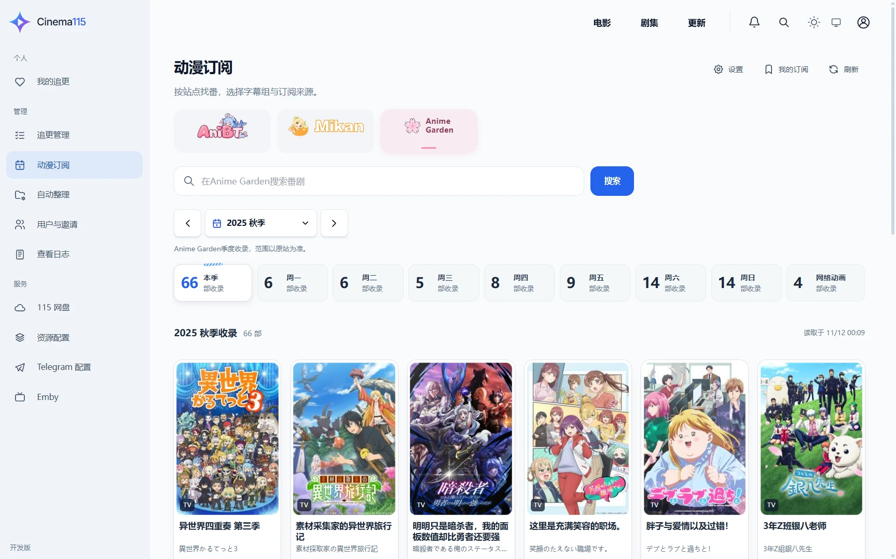
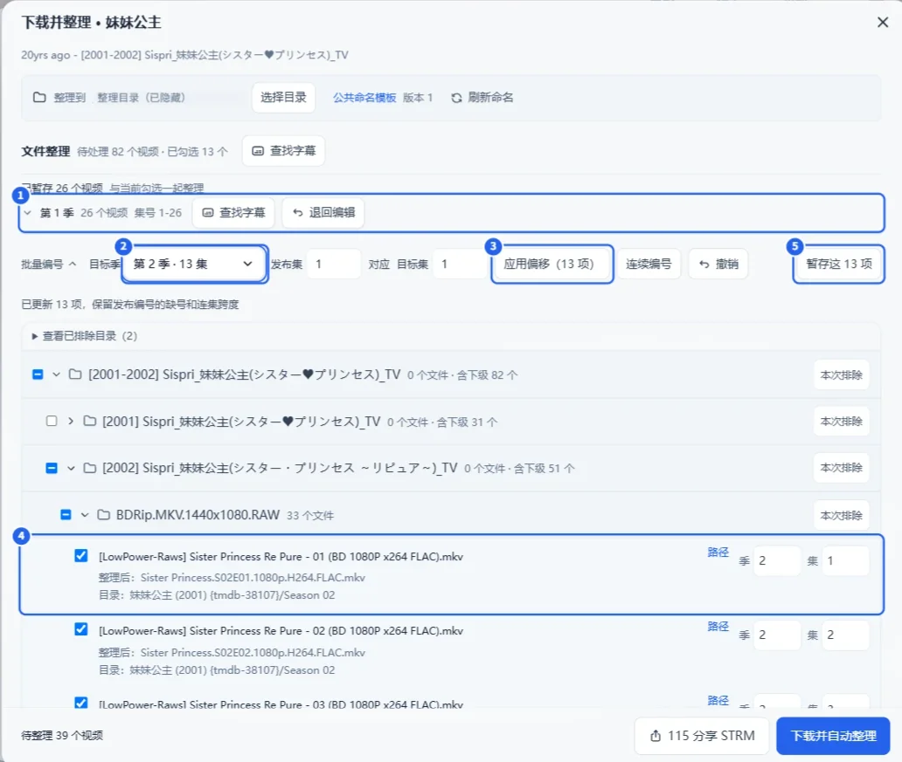
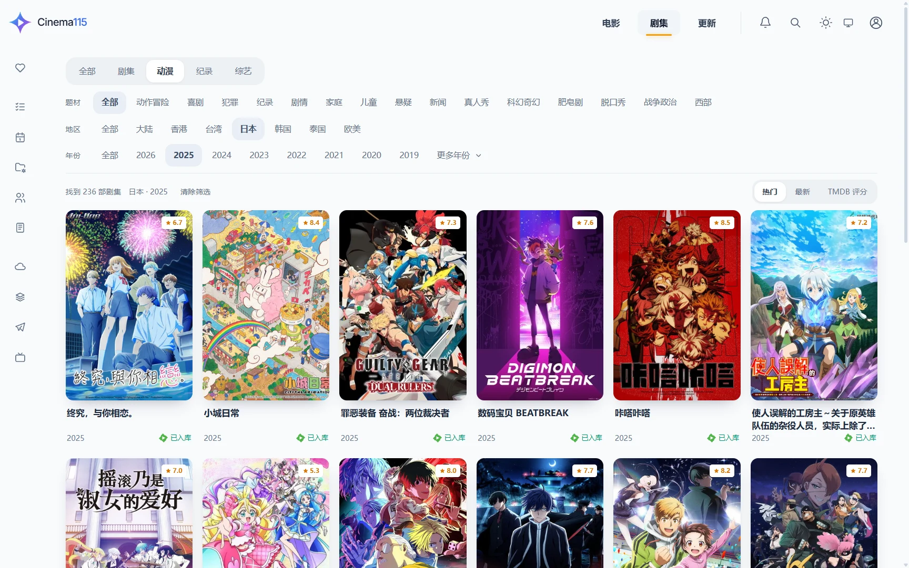
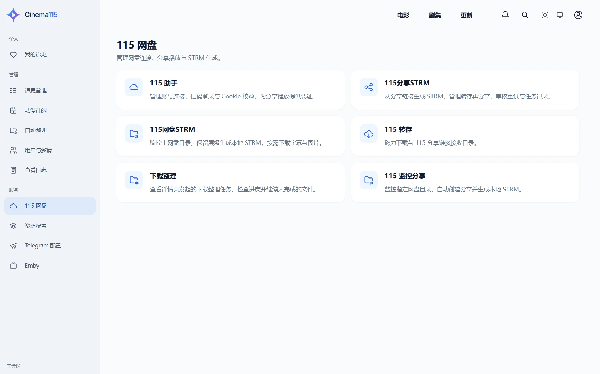

<p align="center">
  
</p>

<h1 align="center">Cinema115</h1>

<p align="center">
  搜索资源、选择正片、匹配字幕，下载整理到 115；也支持动漫订阅、STRM 与 Emby 原文件直链播放。<br>
  网页管理，一个 Docker 容器部署，支持 amd64 / arm64。
</p>

<p align="center">
  <a href="https://github.com/jli452195/Cinema115/releases/latest"></a>
  <a href="https://jli452195.github.io/Cinema115/"></a>
  <a href="https://hub.docker.com/r/jli452195/cinema115"></a>
</p>

<p align="center">
  <a href="https://jli452195.github.io/Cinema115/guide/installation">安装部署</a> ·
  <a href="https://jli452195.github.io/Cinema115/resources/">资源搜索与整理</a> ·
  <a href="https://jli452195.github.io/Cinema115/anime/">动漫订阅教程</a> ·
  <a href="https://jli452195.github.io/Cinema115/guide/appearance">界面与主题</a> ·
  <a href="https://github.com/jli452195/Cinema115/issues">问题反馈</a>
</p>

## 核心功能

| 功能 | 可以做什么 |
| --- | --- |
| **115 转存与 STRM** | 将分享资源转存到配置的主账号目录；从分享链接或网盘目录生成 STRM，支持转存再分享与配套字幕。 |
| **资源搜索与下载整理** | 从详情页搜索种子，查看文件树，排除重复版本，分季选择并暂存正片，下载后重命名、移动到目标目录。 |
| **字幕查找与匹配** | 搜索动漫字幕库与已配置的射手网，或导入本地字幕与压缩包；按季匹配视频、核对语言及目标名称，随视频一起整理。 |
| **动漫 RSS 订阅** | 从 AniBT、蜜柑或 AnimeGarden 选择番剧与字幕组，按规格筛选，自动下载、重命名整理与齐集归档。 |
| **集号核对与命名** | 结合 Bangumi 与 TMDB 核对篇章，预览季集对应与文件名；整理支持应用偏移、连续编号，订阅支持自定义集号正则和备用 RSS。 |
| **任务进度与恢复** | 在下载整理记录中查看下载、整理、字幕与 STRM 进度，按任务状态核对结果、继续处理或重试。关闭搜索弹窗后任务继续执行。 |
| **影视浏览与搜索** | 浏览电影、剧集与动漫，查看 Emby 入库状态；通过已配置的资源站点、Telegram Bot 或频道搜索资源。 |
| **Emby 与用户管理** | 原文件直链播放，支持主网盘、用户个人网盘和动态小号池；提供 Emby 个人中心，以及管理员使用的邀请、播放子账号与会话管理。 |

动漫订阅可独立用于下载和整理，无需先配置 Emby。Emby 播放遵守实时 Emby 授权，仅支持原文件直链，不进行转码或重新封装。

## 快速开始

推荐在 Linux NAS 上使用 Docker Compose 部署。镜像为 `jli452195/cinema115`，一个容器同时提供网页与 API，默认管理端口为 `8115`。

1. 从 [最新正式版](https://github.com/jli452195/Cinema115/releases/latest) 下载附件 `compose.yaml`，放进部署目录。
2. 填写管理员账号、密码、随机 `JWT_SECRET` 和 TMDB API Key，修改 NAS 挂载路径及运行用户 UID/GID。提前创建 `data` 和媒体库挂载目录，并授予该 UID/GID 读写权限。
3. 在该目录执行：

   ```sh
   docker compose config --quiet
   docker compose pull
   docker compose up -d
   ```

打开 `http://NAS_IP:8115`，使用配置的管理员账号登录。在「115 网盘 → 115 助手」创建并登录主账号，再设置所需功能的目录。

配置主账号后，按需要选择入口：

- **整理已有合集**：按[资源搜索与整理](https://jli452195.github.io/Cinema115/resources/)选择视频、核对季集并配字幕；[妹妹公主两季 BDRip 实战](https://jli452195.github.io/Cinema115/resources/sister-princess.html)提供完整图解。
- **自动追番**：按 [AniBT 订阅入门](https://jli452195.github.io/Cinema115/anime/) 配置下载与整理目录、选择字幕组，核对季集后保存订阅。
- **直接转存资源**：在「115 网盘 → 115 转存」配置分享接收与磁力下载目录，再使用搜索结果中的转存或云下载按钮。

Compose 默认使用 host 网络；修改 `HTTP_PORT` 后使用对应端口。完整操作见 [Docker 部署](https://jli452195.github.io/Cinema115/guide/installation)。

更新和迁移时保留原 `JWT_SECRET` 与运行数据，按照 [更新与备份](https://jli452195.github.io/Cinema115/guide/upgrade) 操作。

## 界面预览

**动漫订阅**：按季度、星期与资源站点浏览番剧，进入条目选择字幕组和资源规格。

<picture>
  <source media="(prefers-color-scheme: dark)" srcset="docs/site/public/screenshots/anime-calendar-dark.webp">
  <source media="(prefers-color-scheme: light)" srcset="docs/site/public/screenshots/anime-calendar-light.webp">
  
</picture>

<details>
<summary>查看资源整理、影视浏览与 115 网盘界面</summary>

### 资源整理与字幕

合集按季选择正片、校正编号并暂存，再从各季分组查找字幕。图中演示第一季已暂存、第二季应用 `S02` 编号后的状态。

<a href="https://jli452195.github.io/Cinema115/resources/sister-princess.html">
  
</a>

完整步骤见[两季 BDRip 图解教程](https://jli452195.github.io/Cinema115/resources/sister-princess.html)：查看文件 → 选择正片 → 分季暂存 → 匹配字幕 → 核对提交。

### 影视浏览

按地区、年份和类型筛选电影、剧集与动漫，查看海报、评分和 Emby 入库状态。

<picture>
  <source media="(prefers-color-scheme: dark)" srcset="docs/site/public/screenshots/anime-library-dark.webp">
  <source media="(prefers-color-scheme: light)" srcset="docs/site/public/screenshots/anime-library-light.webp">
  
</picture>

### 115 网盘

从功能总览进入分享 STRM、网盘 STRM、115 转存、下载整理或目录监控等工具。

<picture>
  <source media="(prefers-color-scheme: dark)" srcset="docs/site/public/screenshots/drive-overview-dark.webp">
  <source media="(prefers-color-scheme: light)" srcset="docs/site/public/screenshots/drive-overview-light.webp">
  
</picture>

</details>

截图使用 WebP，动漫订阅、影视浏览与网盘预览按深浅主题选择对应图片。[在线 Wiki](https://jli452195.github.io/Cinema115/guide/appearance) 可查看轮播预览、体验主题切换动效。

## 使用文档

| 文档 | 内容 |
| --- | --- |
| [开始使用](https://jli452195.github.io/Cinema115/guide/) | 安装、首次登录与功能配置顺序。 |
| [115 账号配置](https://jli452195.github.io/Cinema115/guide/accounts) | 主账号、小号与用户个人网盘的用途。 |
| [资源搜索与下载整理](https://jli452195.github.io/Cinema115/resources/) | 搜索种子、选择正片、应用偏移与连续编号、配字幕和追踪任务。 |
| [实战：妹妹公主两季 BDRip](https://jli452195.github.io/Cinema115/resources/sister-princess.html) | 按图完成两季暂存、第一季 26 份字幕、第二季 13 份字幕及最终清单核对。 |
| [动漫订阅](https://jli452195.github.io/Cinema115/anime/) | 选择来源、字幕组、集号映射、整理与归档。 |
| [匹配规则与命名](https://jli452195.github.io/Cinema115/anime/rules-and-naming) | 资源规格、备用 RSS、Bangumi 与 TMDB 对应、集数偏移和预览。 |
| [订阅管理与故障排查](https://jli452195.github.io/Cinema115/anime/management) | 下载记录、整理进度、归档与通知。 |
| [更新与备份](https://jli452195.github.io/Cinema115/guide/upgrade) | 镜像更新、运行数据备份与恢复。 |
| [常见问题](https://jli452195.github.io/Cinema115/faq/) | 页面访问、路径权限与播放问题排查。 |

<details>
<summary>功能与实现说明</summary>

- 网盘与整理：[115 主账号与小号](docs/p115-accounts.md)、[分享 STRM](docs/reshare.md)、[下载整理](docs/garden-download-organize.md)、[自动整理](docs/media-organize.md)。
- Emby：[302 反代](docs/emby-proxy.md)、[入库索引](docs/emby.md)、[个人中心](docs/member-playback.md)、[播放会话](docs/single-playback.md)。
- 资源搜索：[网络代理](docs/network-proxy.md)、[Telegram](docs/telegram-resource-search.md)、[观影](docs/gying.md)、[蜜柑](docs/mikan.md)、[蜗牛](docs/woniu.md)。
- 维护：[数据库](docs/database.md)、[版本发布](docs/releasing.md)。

</details>

## 开发与反馈

项目使用 Go、Vue 3 与 SQLite。本地启动与检查见 [开发指南](docs/development.md)，文档站预览与写作见 [编写文档](https://jli452195.github.io/Cinema115/contributing/)。

反馈问题请提交 [GitHub Issue](https://github.com/jli452195/Cinema115/issues)，附上项目版本、复现步骤与相关日志。发布版本与更新说明见 [Releases](https://github.com/jli452195/Cinema115/releases)。

第三方来源与许可证见 [THIRD_PARTY_NOTICES.md](THIRD_PARTY_NOTICES.md)。本项目使用 TMDB API，但未获 TMDB 认可或认证。
