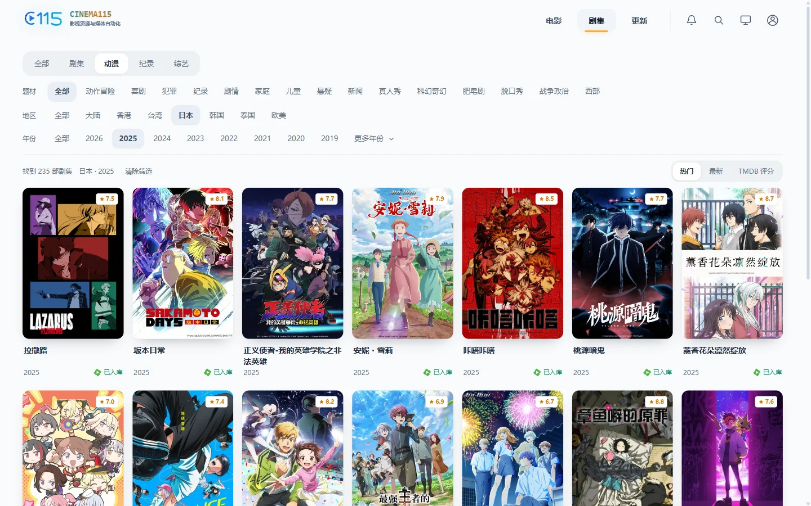
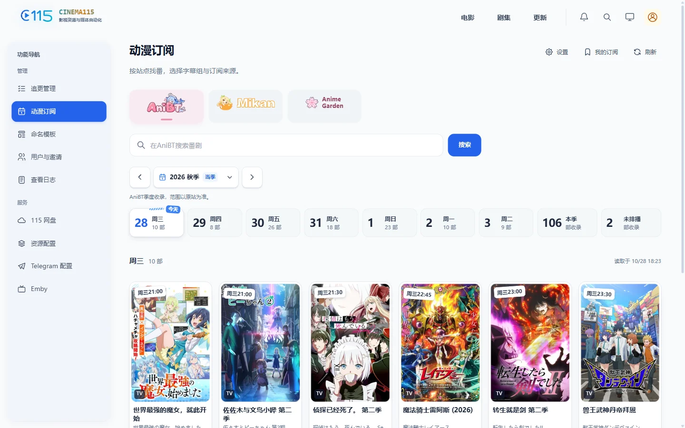
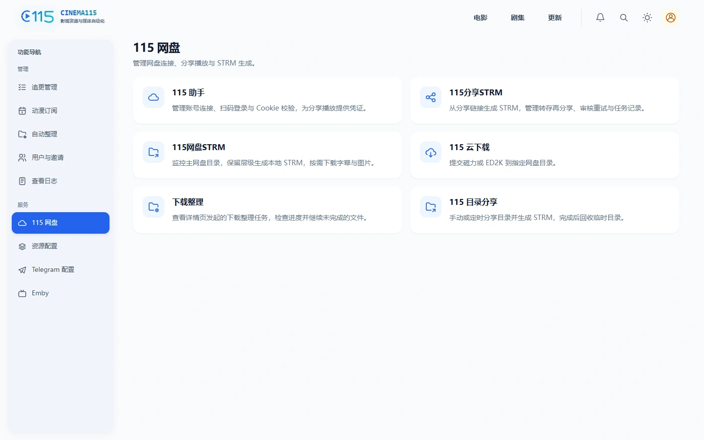

<p align="center">
  
</p>

<h1 align="center">Cinema115</h1>

<p align="center">
  围绕 115 网盘的 STRM 生成、下载整理与动漫订阅工具。<br>
  支持 Emby 原文件直链播放，日常操作通过网页完成。
</p>

<p align="center">
  <a href="https://github.com/jli452195/Cinema115/releases/latest"></a>
  <a href="https://jli452195.github.io/Cinema115/"></a>
  <a href="https://hub.docker.com/r/jli452195/cinema115"></a>
  <a href="https://github.com/jli452195/Cinema115"></a>
</p>

## 界面预览

浏览电影、剧集与动漫，按地区、年份和类型筛选，并查看 Emby 入库状态。



<details>
<summary>查看动漫订阅与 115 网盘界面</summary>

### 动漫订阅

从 AniBT、蜜柑或 AnimeGarden 选择番剧与字幕组，预览匹配结果和整理后的文件名。



### 115 网盘

集中管理分享 STRM、云下载、下载整理与目录分享。



</details>

## 核心功能

- **115 分享与 STRM**：从分享链接或网盘目录生成 STRM，支持转存再分享与配套字幕。
- **下载与整理**：提交磁力或 ED2K 云下载，结合 TMDB 资料预览、校正命名并整理到目标目录。
- **动漫 RSS 订阅**：按字幕组订阅，自动下载与重命名整理，支持缺集补齐和齐集归档。
- **影视浏览与资源搜索**：浏览 TMDB 影视资料，在详情页使用已配置的资源站点、Telegram Bot 或频道搜索资源。
- **Emby 直链播放**：通过 302 反代获取原文件直链，支持主网盘、用户个人网盘和动态小号池。
- **用户与播放管理**：普通用户通过 Emby 登录个人中心，管理员管理邀请、播放子账号及播放会话。

动漫订阅可独立用于下载和整理。Emby 播放遵守 Emby 权限，仅支持原文件，不提供转码或重新封装。

## 快速开始

推荐在 Linux NAS 上使用 Docker Compose 部署。镜像为 `jli452195/cinema115`，支持 `amd64` 和 `arm64`，一个容器同时提供网页与 API。

1. 从 [最新正式版](https://github.com/jli452195/Cinema115/releases/latest) 下载附件 `compose.yaml`，放进部署目录。
2. 填写管理员账号、密码、随机 `JWT_SECRET` 和 TMDB API Key，修改 NAS 挂载路径及运行用户 UID/GID。提前创建 `data` 和媒体库挂载目录，并授予该 UID/GID 读写权限。
3. 在该目录执行：

   ```sh
   docker compose config --quiet
   docker compose pull
   docker compose up -d
   ```

打开 `http://NAS_IP:8115`，使用配置的管理员账号登录，在「115 网盘 → 115 助手」创建并登录主账号，再设置所需功能的目录。

Compose 默认使用 host 网络；修改 `HTTP_PORT` 后使用对应端口。完整操作见 [Docker 部署](https://jli452195.github.io/Cinema115/guide/installation)。

更新和迁移时保留原 `JWT_SECRET` 与运行数据，按照 [更新与备份](https://jli452195.github.io/Cinema115/guide/upgrade) 操作。

## 使用文档

| 文档 | 内容 |
| --- | --- |
| [开始使用](https://jli452195.github.io/Cinema115/guide/) | 安装、首次登录与功能配置顺序。 |
| [115 账号配置](https://jli452195.github.io/Cinema115/guide/accounts) | 主账号、小号与用户个人网盘的用途。 |
| [动漫订阅](https://jli452195.github.io/Cinema115/anime/) | 选择来源、字幕组、集号映射、整理与归档。 |
| [更新与备份](https://jli452195.github.io/Cinema115/guide/upgrade) | 镜像更新、运行数据备份与恢复。 |
| [常见问题](https://jli452195.github.io/Cinema115/faq/) | 页面访问、路径权限与播放问题排查。 |

<details>
<summary>功能与实现说明</summary>

- 网盘与整理：[115 主账号与小号](docs/p115-accounts.md)、[分享 STRM](docs/reshare.md)、[下载整理](docs/garden-download-organize.md)、[自动整理](docs/media-organize.md)。
- Emby：[302 反代](docs/emby-proxy.md)、[入库索引](docs/emby.md)、[个人中心](docs/member-playback.md)、[播放会话](docs/single-playback.md)。
- 资源搜索：[Telegram](docs/telegram-resource-search.md)、[观影](docs/gying.md)、[蜜柑](docs/mikan.md)、[蜗牛](docs/woniu.md)。
- 维护：[数据库](docs/database.md)、[版本发布](docs/releasing.md)。

</details>

## 开发与反馈

项目使用 Go、Vue 3 与 SQLite。本地启动与检查见 [开发指南](docs/development.md)，文档站预览与写作见 [编写文档](https://jli452195.github.io/Cinema115/contributing/)。

反馈问题请提交 [GitHub Issue](https://github.com/jli452195/Cinema115/issues)，附上项目版本、复现步骤与相关日志。发布版本与更新说明见 [Releases](https://github.com/jli452195/Cinema115/releases)。

第三方来源与许可证见 [THIRD_PARTY_NOTICES.md](THIRD_PARTY_NOTICES.md)。本项目使用 TMDB API，但未获 TMDB 认可或认证。
