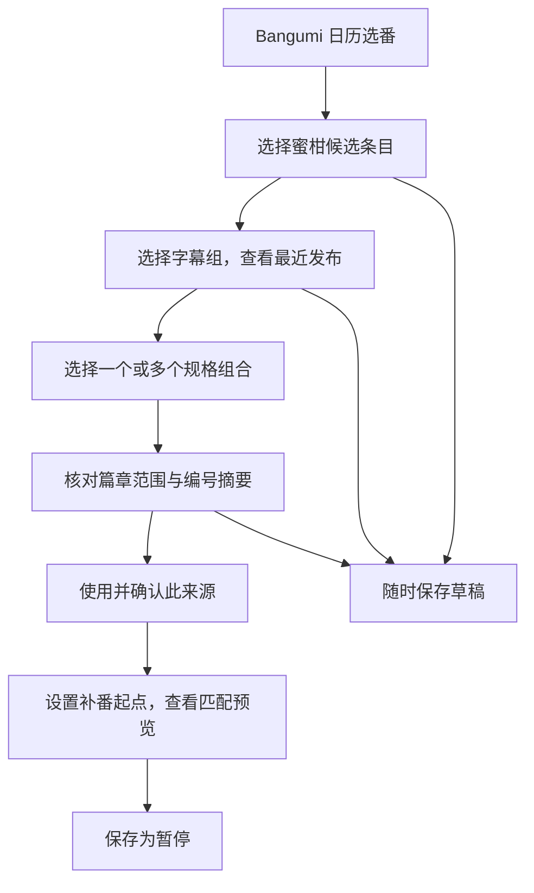

# 动漫订阅交互复盘与调整建议

日期：2026-10-19。状态：用户确认后已实施本轮 P1 交互调整；下载和整理仍按原任务表后续推进。

本次按用户授权，使用其 Chrome 操作 ANI-RSS，结合公开源码、当前项目代码及 Gemini CLI 三轮交互审阅整理。研究操作停在来源选择、待保存表单和预览，没有最终保存订阅或启动下载。保留用户原有标签页与未保存输入。

## 1. 实际观察

ANI-RSS 实站路径为：添加订阅、浏览蜜柑、搜索条目、展开字幕组、添加、选择匹配规格、带入配置、预览。

本次使用与 Cinema115 当前表单相同的样本：Bangumi `418229`、蜜柑 `4063`、绿茶字幕组 `1236`，标题为“魔法少女育成计划 restart”。

| 实站观察 | 结果 |
| --- | --- |
| 展开字幕组 | 可以先看到真实发布标题、大小、时间，再选择规则 |
| 绿茶字幕组的近期发布 | 5 条资源，涉及第 1、2 话，存在 3 种规格 |
| 可选规格 | 1080p 简繁日内封、1080p 繁日内嵌、1080p 简日内嵌，以及全部 |
| 选简繁日内封后 | 自动带入字幕组范围内的匹配规则，不需要手写关键词 |
| 配置预览 | 当前仅匹配 1 条第 1 话；其他规格的第 2 话没有混入 |
| 编号和命名 | 显示 S02E01 及目标目录；其自动选择的 TMDB 与季号仅为观察结果，本次未独立核实正确性 |

以上是当时可见的发布窗口，不是全历史统计。规格来自标题声明，不能视为已经核验文件轨道、编码或容器。

## 2. 调整前流程的问题

1. 用户必须先确认篇章范围、填写核对依据、设定画质并勾选，才能生成资源预览；确认所需的真实标题证据却放在后面。
2. 只有画质下拉框，无法直接区分同组同集的简体、繁体、内嵌和内封。依靠高级包含词填补这个缺口，操作负担较大。
3. 资源选择、业务确认和内部完整性校验混在一个长表单里。手输核对依据后还要勾选，不能有效帮助普通用户判断。
4. 共用的 115 下载目录常驻大侧栏，挤压来源配置；每次创建都像要重新配置下载环境。
5. 主/备用来源重复整套填写，缺少直观的“该组、该版本、从哪话开始”的摘要。

现有历史预览已经是资源行列表，具有匹配原因、部分历史提示、跨页选择和恢复能力，应保留这些实现。宽表格和多层叠加弹窗是 ANI-RSS 中应避免照搬的部分。

## 3. 已实施的操作流程（后续 P3 项另有说明）

### 来源选择器

- 保留独立配置页面及 Bangumi 篇章上下文，复用项目浮层组件作为唯一一层来源选择器。
- 手机端在同一浮层内逐步显示候选条目、字幕组、规格与确认摘要；返回上一级保留搜索、滚动和选择，不再逐层弹窗。
- Bangumi 标题自动带入搜索词。首次进入选择器可发起一次候选搜索并复用缓存；不随每个输入字符重新查询，不自动绑定最高匹配项。
- 字幕组改为紧凑可展开行，点击后才读取该组样本。默认展示少量原标题，其余按需展开。
- 最后一屏展示两个条目、字幕组、已选规格、来源作用范围和编号关系；“使用并确认此来源”同时完成必要的人工确认，不再增加单独确认弹窗或重复勾选。
- 未完整填写范围或对应时，就近显示缺少什么；确认操作定位首个问题并保留其他输入，不能只显示一个没有解释的灰色按钮。

### 来源配置摘要

每个来源收起后直接展示：角色、字幕组、所选规格、补番起点、编号规则。例如：

| 项目 | 普通新番示例 |
| --- | --- |
| 来源 | 主 RSS，绿茶字幕组 |
| 规格 | 1080p 简繁日内封 |
| 补番 | 从发布第 1 话开始，包含本话 |
| 编号 | 发布话数与篇章集数一致，经用户确认 |
| 范围 | 用户确认整个所选来源属于本篇章，或明确限定编号范围 |

备用 RSS 使用同一个选择器，但独立保存规格、范围、起点、编号及启用意图。保留用户要求的主/备用名称，附近仅用一条低强调说明“各来源独立运行，同集不同版本分别保留”。

已选来源提供“修改规则”，重新打开时回填该来源的规格、范围和对应；不要求为了改规格删源重建。条目/字幕组身份更换仍遵守现有来源身份边界，不能当作普通规则编辑静默替换。

### 起点、范围与偏移

- 起点继续默认填 `1`，按字幕组标题编号。已读最早话或最新话只能作为建议，不能暗改输入。默认首次策略仍是从指定话数补齐当前已加载资源。
- 普通新番显示“建议保持原编号”，明确确认后生效；不能把编号相同的建议当作已核实事实。
- 连续编号展开为“发布第 25 话对应篇章第 1 集”，旁边显示 25 对应 1、26 对应 2。内部偏移为 `篇章基准 - 发布基准`，不要求用户判断正负数。
- 篇章范围与补番起点独立。例如范围为 25～36、对应 25 到篇章 1、补番从 30 开始，应显示篇章第 6 集起补。
- 总集数未知时不推断范围终点。用户可以明确确认整个来源属于当前篇章；混篇章来源须限定范围，未确认时保留草稿。
- “整个来源属于本篇章”是对今后该源发布的作用范围声明，不能因样本标题相似自动确认。未来识别异常继续进入待核对状态。

### 规格选择

建议比 ANI-RSS 的单选再进一步：同一字幕组内允许多选实际观察到的规格组合，避免为同组不同版本重复添加 RSS。

- 已选组合之间为“任一满足”，组合内明确指定的维度必须同时满足。
- 简体、繁体、简繁是明确区分的字幕集合；内嵌与内封区分。HEVC/H.265、CHS/简体等别名应统一解释。
- 规格为结构化约束，不能冻结整个原标题作为模板。未指定的维度不限，新增无关标签不应使旧规则失效。
- 标题中缺少用户要求的规格信息时标记未知，不猜测满足；提取应关注规格片段，不能把作品名里的“日”等字直接当语种。
- “全部规格”与指定组合互斥，只能显式选择，并就近说明可能保留同集的多个版本。
- 仅有一种规格也展示其样本与选择状态。没有可识别规格时可手动选择不限，或使用高级字面包含/排除词；不新增任意正则输入。
- 零匹配不自动换组、放宽为全部或改起点。未知规格、标题格式变化可显示为待核对。
- 组合选项来自已读窗口，更多历史可能带来新组合；不自动把新组合加入订阅。
- 可显示“当前样本命中 1/5 条”等局部计数，并明确只针对已读窗口；正式预览仍为有界历史，不能称为全量统计。

### 最近发布与匹配预览

| 区域 | 最近发布 | 匹配预览 |
| --- | --- | --- |
| 作用 | 帮助选择条目、字幕组、规格和编号 | 核对正式规则和已加载历史选择 |
| 前提 | 选定真实条目和字幕组 | 来源及规则完整，满足现有预览版本约束 |
| 资源复选框 | 无 | 有，保留多版本与跨页选择 |
| 115 目录 | 无需有效目录 | 不新增有效目录前置；保存为暂停和未来执行分别校验 |
| 说明 | 近期样本及其读取时间、边界 | 已读、符合、需确认、已选和未加载历史 |

两处都内联呈现，不各开一层弹窗。样本用“最近发布”命名，正式区域用“匹配预览”；当前 P1 始终准确说明只保存配置，不显示“开始订阅下载”。

手机端保留现有列表方向：标题可展开，编号、规格、大小和匹配原因自然换行，不能硬性压成两行导致关键信息被截断。规格不能只靠悬停提示解释，键盘、点击和触屏均可查看。

同集的各行显示所选规格，方便核对。用户明确选择多个版本后，这些版本都应按原首次历史策略处理；不因集号相同取消默认选择，也不新建“重复版本”警告。

### 下载存放与整理

- 共用 115 主账号及下载目录缩为常驻紧凑摘要，保留更改入口；缺失、换号或失效时就近展开处理，使用低强调提示。
- 查看资源样本不依赖目录配置。保存为暂停、未来启动任务继续在服务端校验目录归属，任务固定账号与设置，不回退其他账号。
- 每条资源独立子目录的约定保留；不同规格也不互相覆盖。
- TMDB 不作为找资源或下载的入口。P3 到来后在同一配置页展开“整理与命名”，直接展示发布话数对应最终 SxxExx 与路径，复用已确认的篇章对应，避免用户再重复填一套偏移。
- 本轮 P1 调整不展示尚未实现的自动整理开关；普通下载仍可独立于 TMDB 命名运行。

## 4. 后端复核与复用边界

本部分由 Codex 核对当前实现，不能仅根据 Gemini 的页面建议省略服务端校验。

1. 已有 `POST /api/admin/anime/source-bindings/preview`，调用 `AnimeBindingService.PreviewBinding`。允许 `confirmed=false`、`scope=null` 的绑定输入，验证实际条目/字幕组归属后读取单组 RSS，返回标题、解析及未确认投影；前端现已接入，同一入口附带规格选项与样本时间，不新建重复探测链路。
2. 现有 `ReadAnimeMikanEntry` 只返回条目/组元数据，不抓各组历史；来源选择器继续按组读取，不能加载候选时抓完所有字幕组。
3. 正式历史预览已有共享缓存、站点限流、预算、快照和过期恢复。规格切换可先使用同一份样本反馈，正式匹配由后端一致计算；不能每点一次就重新抓站点，也不能把样本反馈当成下载授权。
4. `confirmed_chapter` 已支持显式 `review: {method: "source_review", itemId, groupId}`，与所选范围、对应一起持久化。服务端验证确认状态、方法和真实来源身份；保存仍经过管理员鉴权、版本与幂等回执。保留原有合法 evidence 输入的读取能力，不填造假说明。未确认草稿允许范围不完整，正式暂停规则仍严格校验。
5. 已增加 `specMode=profiles/any`、`specProfiles`，结构化维度含分辨率、语言集合、字幕模式、编码、位深、容器。组合间 OR、组合内指定维度 AND；语言集合精确区分，未知必需维度进入待核对。ParserVersion=3、SpecVersion=2、RuleVersion=2，已纳入预览指纹。组合排序/去重不修改调用方，空集合持久化不产生无效来源修订。
6. 一个订阅内同一蜜柑条目/字幕组已有来源唯一性校验。多版本属于同一来源内的规则，保留现有来源身份约束；执行时仍按资源 Hash 幂等，同集不同资源允许共存。
7. 来源、范围或对应改变时更新相应确认与预览状态；仅改补番起点或规格不应丢掉已经核实的来源身份，但必须重新计算规则预览。目录改变不使最近发布消失，正式预览按现有设置版本失效规则处理。

## 5. 本轮实施与验收

下表三项本轮均已完成，证据见文末；这是已有 P1-09/10 的交互优化，不增加主任务表完成数量，不提前代替 P1-11/12 阶段验收。

| 顺序 | 调整内容 | 完成标准 |
| --- | --- | --- |
| 1 | 接入已有只读来源样本；下载目录收为摘要；来源选择器改为单层逐步浏览 | 未确认范围、没有有效目录时能看到真实近期发布；失败/返回保留输入；只读动作不创建订阅、历史选择或下载 |
| 2 | 结构化规格解析/组合规则及多选 UI；来源确认凭据契约；普通/连续编号摘要 | 绿茶三种规格能分别筛选或组合；未知所需规格不命中；起点不暗改；25 对应 1、从30补对应篇章6；多源不继承规则；零匹配不放宽 |
| 3 | 合并来源确认动作；衔接历史预览/草稿/暂停与缓存恢复；Gemini CLI 审查实际实现和截图 | 无小作文/重复勾选；服务端拒绝缺失确认、无效方法与来源不符的确认；修改规则触发正确失效；同集多版本保留；桌面/320px/键盘/触屏、部分历史、零资源及失败路径通过 |

本轮模型、解析/规则、来源样本、前端及回归一起交付。P1-11/12 阶段验证和 P2/P3 后续任务仍保持未打卡。

## 6. 参考与审阅记录

公开源码固定参考提交：`d59e52db3b971cf03ba54f5447deaad587ac0175`。未验证该提交与用户部署版本完全一致；实站观察与源码解释分别记录，不据此声称线上完整行为相同。

- [MikanView：懒加载、规格选择与回填](https://github.com/wushuo894/ani-rss/blob/d59e52db3b971cf03ba54f5447deaad587ac0175/ani-rss-ui/src/view/home/MikanView.vue#L258)
- [GroupRegexUtils：从实际标题生成规格组合](https://github.com/wushuo894/ani-rss/blob/d59e52db3b971cf03ba54f5447deaad587ac0175/ani-rss-application/src/main/java/ani/rss/commons/GroupRegexUtils.java#L15)
- [BatchAdditionView：带入配置与最终保存分开](https://github.com/wushuo894/ani-rss/blob/d59e52db3b971cf03ba54f5447deaad587ac0175/ani-rss-ui/src/view/home/BatchAdditionView.vue#L64)
- [StandbyRssView：备用来源列表及独立偏移](https://github.com/wushuo894/ani-rss/blob/d59e52db3b971cf03ba54f5447deaad587ac0175/ani-rss-ui/src/view/home/StandbyRssView.vue)
- [PreviewView：正式预览](https://github.com/wushuo894/ani-rss/blob/d59e52db3b971cf03ba54f5447deaad587ac0175/ani-rss-ui/src/view/home/PreviewView.vue#L234)
- [ItemsUtil：筛选、组范围与按集号去重](https://github.com/wushuo894/ani-rss/blob/d59e52db3b971cf03ba54f5447deaad587ac0175/ani-rss-application/src/main/java/ani/rss/util/other/ItemsUtil.java#L218)。本项目不采用其按集号去重和覆盖行为。

Gemini CLI 会话：`08a6aa6b-5d5a-41c0-99c2-d6f6930acc2f`，只读三轮。第一轮读取当前三个 Vue 组件，之后根据 Codex 的实际 DOM 观察与后端事实纠偏。这三轮为方案审阅；实际实现和 PNG 在下述新会话中审查，不能混作同一次验收。

采纳：先样本后规则、实际规格组合、单层选择器、目录摘要、确认动作合并、缺漏定位、局部计数、版本标识及手机返回修改的状态保留。未采纳：自动将来源确认成整个篇章、自动选中最高搜索结果、按当前窗口暗改起点、以假 evidence 免改后端、引入任意正则、改名为通道、将有效目录新增为预览门槛、把用户选定的多版本作为重复异常。最终规则以本提案的边界和用户既有约定为准。

## 7. 实施、审查与验证证据

- 单层 `AnimeSourcePicker` 复用 `AnimeFloatingDialog`；条目→字幕组→规格/范围/编号，返回保留搜索与各步骤滚动；样本只读，切规格复用有界两分钟缓存，换组取消旧请求、迟到数据不能覆盖。
- 最近发布默认一条完整标题，其余展开；样本时间、已读窗口、规格计数和多规格标题说明均就近展示。首次样本加载禁用确认；无样本失败可显式选全部并确认范围，也可保存草稿。
- 确认操作通过共享浮层 footer 插槽常驻滚动区外；规格/范围/编号错误就近显示并定位，不再把错误留在不可见的最底部。Escape 恢复启动按钮焦点。减少动效偏好下错误定位不平滑滚动。
- 来源范围无预填，用户主动选后才能确认；原编号仅为建议，点击确认才记录对应。确认只校验本步骤，不被外面的半填补番/关键词干扰。起点始终默认 1。
- 下载目录收为共享摘要；历史预览、部分历史、选择 CAS 和结果不明时原键/原文重试完整保留。未引入 Emby 或下载执行依赖，也未新增数据库迁移。

Gemini CLI 实施审查：

1. `c45947c4-5531-4dcc-a2df-89275a7e0e80`：代码首审；落实显式范围、全部规格反选、初次读取禁确认、异常不关窗、错误靠近操作、列表忙碌不移走焦点等问题。
2. `b56fb2cc-39c8-4153-b919-07c8ca13f99b`：读取桌面编辑页、桌面/320px 选择器实际 PNG 及组件；发现长样本、确认按钮不可发现和错误定位脱节。
3. `c5e086eb-c80b-471e-9b2d-0e92d53e7c29`：读取修正后的桌面/320px PNG、选择器/共享浮层/CSS；确认常驻操作栏、样本折叠、错误定位及失败降级已解决，没有剩余阻塞意见。临时审阅副本仅复制模拟截图，不包含凭据或真实业务资料。

验证：配置页 14 组、日历 10 组、列表/详情 10 组，共 34 组模拟浏览器场景通过；类型检查与生产构建通过，无浏览器运行时异常。Go 的 model、animeparse、animebinding、animepreview、service、storage、httpapi 动漫相关回归、go vet 与全后端编译通过。新增规格别名/连写、未知必需维度、多规格 OR、同集多版本、来源确认身份、持久化与无修订抖动等测试。既有 libarchive-wasm 外置模块及分包大小提示仍存在。

真实 Chrome 仅操作来源选择及读取：Bangumi 418229 / 蜜柑4063 / 绿茶1236读到5条、3种规格；另核对下述银色子弹100条。未保存真实订阅、未更改真实115目录、未启动下载或整理。模拟截图保存在忽略目录 `frontend/test-results`。

## 8. 银色子弹与 ANI-RSS 的匹配机制

用户补充名侦探柯南（Bangumi899、蜜柑227、银色子弹161）截图后，复现语言漏识别：`[繁日双语MP4]`、`[简日双语MP4]`、`[简繁日多语MKV]` 连写标签未被初版识别。

对照固定参考提交的 `GroupRegexUtils.REGEX_LIST`：它逐个在完整标题中查找 `1080[Pp]`、`简`、`繁`、`日`、`mp4|MP4`、`mkv|MKV` 等固定表达式，每条标题的命中列表形成一个组合，相同组合去重。`MikanView` 保存所选组合的表达式数组；`ItemsUtil` 要求非空匹配数组的每一条表达式都 `contains` 标题，排除数组任何一条命中即剔除；全部是空数组。它没有把这些词拼成一个复杂正则。

本项目吸收固定标签组合思路，补齐双语/多语、繁简体及连写边界，仍保留结构化字段：不会把作品或分集名里的“日”认作语言，不从 MP4/PGS 猜测内嵌/内封，不把多个容器冲突缩成不限容器的可选规格。语言集合精确区分，多选组合 OR，同集版本均保留；不照搬 ANI-RSS 按集号去重。

本次100条真实标题已固化为 `backend/internal/animeparse/testdata/silver_bullet_titles.json`，仅含公开发布标题。实站来源样本接口复核与测试均得到：简繁日 MKV34条、繁日 MP4 30条、简日 MP4 30条；另6条在单个标题列出多个容器，计入 `profileReviewCount`，不生成含糊的第四种“1080p”选项。指定容器的预览对缺失/冲突信息按未知处理，不放宽匹配。
