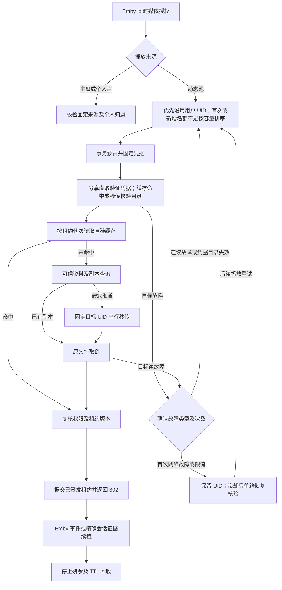

# 动态播放池

共享池用户保存 `source=assigned`，由服务端记录最近成功分配的账号及 UID；不由管理员手动绑定。Emby 仍负责登录身份和媒体权限，Cinema115 负责播放来源、账号调度和取链。个人网盘及播放子账号的归属与拒绝规则保持独立。

## 调度与故障切换

播放协商不触发池取链或写入。秒传结果不明不会走换号重试边；源盘、个人盘和 Emby 权限故障也不会沿此边进入公共池。

正式取链先验证 Emby 用户、条目和媒体源。同一服务下同一用户优先沿用已成功分配的账号配置及 UID，换设备、换片或空闲后重播先复用已有名额；原 UID 健康但确实需要新增名额且已满时，允许选择其他有空位的健康 UID。分配持久化但不占容量，删除用户时一并清理；删除配置后新建同 UID 配置不继承原分配。首次分配或容量切换按 UID 剩余容量选择，同负载参考本地已验证副本后轮换，不逐账号访问 115。选择与预占在同一锁内持久化，并发准备沿用同一目标，目标满载时不再向第三个 UID 扩散。容量或故障切换仅在新目标成功取链提交后更新用户分配；失败保留旧分配，旧账号恢复或空出名额后不自动切回。已有正式会话可复用原名额，其刷新不回写新的默认分配。容量不足不处罚账号健康或触发冷却。重复 UID 不增加候选权重。停止新分配的账号仍可服务已有会话，禁用、删除、目录或凭据变化使旧结果不能直接签发。

正式分享 STRM 缓存未命中时，用固定目标的实际分享取链验证凭据，成功直取不再先查询保存目录。缓存命中仍实时检查；明确分享不可读后，先核验目录再进入秒传。已知目录失效账号仍被排除；尚未发现的目录故障不阻断不需要写入的分享直取。分享成功不刷新完整目录健康记录，后台检查及更新故障的提交拦截仍有效。PickCode 和下载保持原核验流程。详见[验证记录](share-direct-authorization-validation.md)。

已认证设备有稳定名额：服务、用户、登录返回的设备与播放器摘要相同，优先沿用设备当前健康目标，即使其他 UID 空闲也不因换片漂移。设备下各会话仍有独立租约与代次，同 UID 容量按设备去重；缺少可信设备身份、下载及手动秒传继续按独立租约计数。正在服务该设备的账号进入停止新分配状态后仍可供它连续播放。

首次网络错误或 HTTP 5xx 先短暂冷却，默认约 10–12 秒，保留原 UID；冷却到期后优先单路核验原账号，连续第二轮失败才允许有界换号。凭据或目录明确失效可切换，限流遵守原冷却期限且不借换号绕过。并发观察到的同轮故障不累计次数；本地排队超时不处罚账号。恢复核验保留真实目录检查，正常只读取链继续走快速路径。源文件故障、Emby 拒绝、取消及写入结果不明不触发换号。探测与取链共用候选次数和截止时间，没有递归重试。池空、全失效或全忙返回 503，不回退主网盘。

账号配置分别保存凭据。同 UID 多配置共享容量、API 速率和限流冷却，不复制 Cookie。池表只保存设置、用户分配、账号/UID、版本、目录、会话摘要、代次、健康及到期时间，不保存原始 token、Cookie、CDN URL 或签名。直链缓存沿用原有内存机制，使用目标及租约代次隔离。

## 会话与回收

租约键包含 Emby 服务、真实用户、token 摘要、PlaySessionId、条目、媒体源及播放/下载动作。PlaybackInfo 返回的 PlaySessionId 会带入改写的播放地址。客户端没有该字段时，同一 token、条目和媒体源保守合并；无法识别同一 token 同片同时打开的多个 CDN 连接。

播放协商不占容量、不准备网盘文件。正式取链预占后实时检查目标，302 返回前再次核验来源、版本和权限，并将预占标为已签发。未签发请求结束即释放。相同会话并发请求串行等待，排队有界且可取消。

Emby 接受的当前 token 的 Playing/Progress/Stopped 事件可以更新已有租约；独立 Ping 仅在已认证会话唯一匹配时处理，不读取客户端 UserId 作身份。租约续期最多每分钟一次；用户会话的最近播放证据随有效事件持久化，用于阻止接替仍活跃的播放。正常停止后最多保留两分钟残余占用；同设备同 UID 的残余不会重复计费，下一次成功签发可承接名额。迟到心跳不复活已停止会话。并行策略跨 UID 故障切换的旧名额同样最多保留两分钟，同设备最多涉及三个未到期 UID，超过时等待残余到期。没有通知时按配置 TTL 回收，重启保留已签发占用，后台每分钟清理到期记录。

设备策略默认“多设备并行”，管理端可选“单设备心跳熔断”（默认静默 60 秒、范围 30–180 秒）。熔断只在真正取链时限制同一用户的其他设备；缺可信设备关联须通过反代重新登录。同设备仍复用名额，旧设备心跳恢复则取消接替。新设备优先沿用健康 UID、准备时借用旧名额（含正常停止后的可信设备名额），成功提交时事务退休旧会话并释放旧逻辑占用，不留下接替容量残余；换 UID 时新目标仍需空位，失败保留旧状态。下载和手动秒传不参与转交。旧直链可能继续使用，这个策略接受逻辑容量低于实际连接数。详见 [设备策略与容量转交](playback-device-policy-validation.md)。

[同设备连续播放接替](device-playback-handoff.md)对唯一、静默的旧正式会话仍要求新播放证据；容量复用独立于这个接替判断，无须先让当前播放失效。下一片候选与当前播放共用设备名额，最多一个准备任务；当前片刷新不被候选网络操作阻塞。无上报时保留一个保护中的首播和一个候选，候选固定 90 秒期限，新候选准备成功才淘汰旧候选；重复取链不会延长候选期限。已确认的持续活跃会话保留独立生命周期，同设备仍计一个逻辑名额，不能等同真实 CDN 连接并发。

存在活跃租约时，每分钟最多使用已配置 Emby 管理接口只读查询一次 Sessions，超时 4 秒。仅服务 ID、真实 Emby 用户、PlaySessionId 和影片完全匹配，且最近 90 秒内有 LastPlaybackCheckIn 时续期；浏览 LastActivityDate 不续租，重复快照不会按轮询时间延长。持久化只保存匹配摘要。无对应字段、查询失败、空列表、停止、残余或已过期记录均不提前释放或复活。不要求所有 Emby 版本提供 PlaySessionId，缺字段继续采用 TTL。

下载使用独立租约键，与播放合计 UID 容量；不使用播放停止事件释放。手动秒传在启动时选号，保留最多 85 秒预占，任务最长 80 秒，结束即释放；写入开始后始终固定目标，不换号重发。

管理端手动秒传只提供动态池用户，不能借此读取或写入个人网盘。个人网盘文件准备仍在用户本人的已授权播放请求中完成。

这些数字是业务准入估计。302 后客户端直连 CDN，无法精确统计连接数、确认下载完成、立即撤回旧链接或限制实际下载带宽。复制直链和不报告停止的客户端可能使实际并发与业务计数不同。

## 默认参数

| 参数 | 默认 | 可配置范围 |
| --- | --- | --- |
| 每 UID 总会话容量 | 3 | 1–20 |
| 每请求候选 UID 数 | 3 | 1–3 |
| 取链总预算 | 90 秒 | 5–90 秒 |
| 单次登录/目录探测 | 8 秒 | 固定，受总预算约束 |
| 无停止通知的保守保留 | 5 分钟 | 5–1440 分钟 |
| 故障冷却基准 | 30 秒 | 5–3600 秒；首次网络故障约 10–12 秒 |
| 每 UID API 间隔 | 250 毫秒 | 100–10000 毫秒 |
| 全局 API 间隔 | 50 毫秒 | 10–1000 毫秒，不大于 UID 间隔 |
| API 等待队列 | 64 个、最多排期 3 秒 | 固定 |
| 会话准备并发/等待者 | 各最多 128 | 固定 |
| 持久化租约 | 最多 4096 | 固定 |

默认租期仅在尚未保存池设置时使用；已有设置保持原值，已有租约的到期时间也不会随默认值修改。有效播放事件或匹配的 Emby 会话观测可以续租，因此 5 分钟不是影片最长播放时间，也不保证退出后恰好 5 分钟释放。

HTTP 429 触发全局退避，至少 5 秒且尊重更长 Retry-After。限流状态持久化在账号/UID 健康记录中。API 限速覆盖池播放及手动秒传上下文中的主源、目标和校验来源 API；原有凭据级队列保留，其他资源管理任务沿用各自限速。CDN 片段读取受原有大小和超时预算约束。

自动健康检查每分钟最多选择一个待检查账号，成功检查至少间隔五分钟并加 0–15 秒稳定抖动。网络故障首次短退避，第二轮使用配置的冷却基准，后续指数退避至五分钟；基准超过五分钟时不缩短其设置，其他健康故障保留原退避规则。网络恢复检查到期即可由前台触发，不必等待后台定时器。后台优先让出前台请求，持续负载下每五分钟仍允许一次受限恢复机会。探测 API 使用低优先级预算，繁忙时跳过，不积累独立无界队列。没有主动预热任务或自动清理带来的后台写入竞争。

管理员重新检查按 UID 去重，完成后 15 秒内不能重复；全局或同 UID 限流冷却不可被手动检查绕过。未知或恢复中的 UID 只允许一个准备请求进入。凭据失效和目录失效分别隔离；目录错误保留结构化上游类别。健康结果带序号，旧检查或旧取链成功不能覆盖更新的失败，失败晚到时拒绝旧结果签发。每次正式播放仍实时核验，后台健康结果不能当作播放授权。目标云端写入按 UID 串行，不同 UID 最多四路。

源盘或校验来源返回 HTTP 429 时，同样保存全局冷却期限，但不把来源故障记到所选目标账号。请求完成时以独立的两秒本地存储预算保存该状态；存储失败会记录安全错误。

## 单小号与运行观测

播放请求仍在 Emby 用户/条目权限与 STRM 解析之后、115 核验和取链之前判断准入。拒绝时由反代返回 503，不触发额外 Emby STRM 请求或通知。容量已满、恢复期间已有准备请求、停止新分配、系统保护上限分别返回不同文案；多个 UID 因不同条件被排除时返回混合原因，避免把所有问题写成容量已满。

管理员调度日志在判断准入的同一临界区保存快照：原因码、请求/等待者/记录数、每 UID 占用与上限、准备/活跃/残余数、最近未过期租约到期时间。按 UID 去重，最多展开八个 UID；不包含其他用户或会话标识、Cookie 或直链。时间使用带 Z 的 UTC 时间，仅表示当前租约到期估计，续租可能延后，不保证到点有空位。播放器只收到简短原因，不收到内部诊断快照。

一个主号加一个小号即可运行。主号不计入播放池备用容量；唯一小号失效、目录无效或限流时，新播放分别返回可理解的 503，等待修复或后台复查，不重复尝试同一 UID。增加健康小号后自动参加调度。

管理页每 10 秒只读刷新占用、状态和指标，不触发 115 探测，也不覆盖尚未保存的设置。展示准备/活跃/残余会话、冷却、最近安全原因、成功率、切换次数、最近 256 次完成请求的 p50/p95、UID 峰值、API 等待、队列拒绝、429、源盘 API 放行和成功副本路径/直链缓存次数。计数重启归零；延迟含失败与重试，表示反代取链准备耗时，不是播放器起播耗时。API 指标覆盖使用共享预算的媒体取链、任务和探测；副本路径计数不是“省去上传”的严格命中率。

本轮另增加有分母的换 UID 请求比例、已有副本复用率、设备冲突/容量拒绝/成功容量转交计数，以及按阶段和来源分类的 API 放行统计。每次请求最多 32 条候选诊断，超出记截断数；日志沿用请求关联编号。定义、错误决策矩阵及可重复模拟基线见 [实施与验证记录](pool-policy-followup-validation.md)。

健康事件与健康状态同事务持久化，最近最多 100 条，同配置同状态十分钟内去重，初次成功不作为恢复事件。默认只在管理页展示；管理员明确选择已启用且配置通知聊天的 Telegram Bot 后，才把此后故障/恢复事件送入现有通知队列。每轮最多入队一条，稳定事件键防重复，失败重试复用既有通知机制；旧事件不转发给新 Bot，不补发超过一小时的积压。测试只写临时库并模拟发送，未发送真实通知。

## 部署与使用

仅支持一个活动后端。同一 DATA_DIR 使用操作系统文件锁，第二实例启动失败；崩溃自动释放锁。不要删除运行中的 server.lock，也不要以不同数据目录运行多个服务后宣称共享容量。

在 115 助手配置小号登录及目录，在 Emby 用户管理中选择动态小号池来源。池设置可控制容量、时间和限速，账号支持参与调度、停止新分配、禁用和重新检查。降低容量不撤销已发 CDN 链接，只限制新分配。

本次无旧固定分配迁移或双轨运行，不需要清空用户、邀请或个人网盘。数据库结构版本为 34，包含独立的[用户播放会话记录](single-playback.md)；同一用户多个会话各自记录，跨设备准入由设备策略决定。

## 验证边界

自动测试涵盖原子容量、同 UID 去重、会话稳定与恢复、残余占用、停止事件身份范围、数据库失败、取消、共享重试次数、目标取链故障切换、手动任务固定目标、限速及进程锁。浏览器测试使用模拟 API。

已增加用户 UID 跨重启保持、满载切换与名额复用、并发预占不超额、旧会话刷新不回写默认分配、首次超时保留原号、并发故障去重、单路恢复、事务切换失败及旧请求拦截测试；模拟 HTTP 链路验证满载切换、503 重试提示及冷却期间不请求 115。单小号隔离、健康序号、退避、通知及重启对账测试保留。未使用真实 Emby/115 账号进行本轮故障演练，未测得真实取链性能或官方安全并发阈值。
