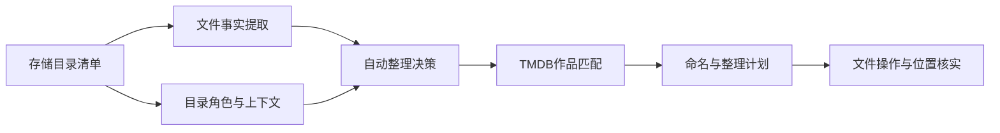

# 结合网盘目录树的解析器重构讨论稿

更新时间：2026-11-03。标准坐标、目录解析和前轮结果精简已完成回归；本轮继续收拢记录、附件和操作保护，完整验证结果待收尾补充。调查范围为 `/115open/Cinema115`，排除 `c115离线目录`；目录调查仅做只读访问，未执行真实云盘整理。

按最新讨论收窄为网盘自动整理：文件事实只提取一次，目录按角色补充信息，再统一生成整理决定。复用已有名称规范化和 TMDB 选择能力，页面、日志与持久化只保留最终结果及恢复必需状态。

当前记录约定：**成功、失败均保留历史，只有明确删除或清理全部成功时才移除对应记录**。成功记录保留必要查询字段和真实完成时间，附件失败不回退视频成功。第 13～16 节中“只保留失败”的实现与测量属于此前版本；本轮按第 18 节纠正，不能据此继续删除成功历史。

范围已确定：优先支持规范剧集文件、规范电影文件及作品／季目录；复杂磁力发布命名不作为兼容目标。NFO 只作为附件处理，不读取正文，不参与作品识别。离线目录继续排除。

## 1. 最新读取范围与完整清单

通过 CD2 官方 `GetSubFiles` 接口，递归读取 `/115open/Cinema115`。用户随后明确不考虑 `c115离线目录`，最终导出清单及本文分析均已排除其内部文件。离线目录本身只保留一个“已排除”标记。

此次读取区间为北京时间 16:43～16:49。按最终范围，共读取 **667 个目录、14,660 个文件条目**，其中视频扩展名条目 **8,972 个**；遍历队列已清空，没有目录读取错误。只读取文件身份、名称、路径、类型、大小和修改时间，没有读取媒体流或字幕、NFO 正文，没有执行云盘文件操作。

| 一级目录 | 读取目录数（含分支根） | 文件条目 | 视频条目 |
| --- | ---: | ---: | ---: |
| c115动漫 | 13 | 2,566 | 2,539 |
| c115整理测试 | 623 | 12,058 | 6,401 |
| cd2监控测试 | 27 | 36 | 32 |
| Detective Conan.1996 | 1 | 0 | 0 |
| c115整理完成目录 | 1 | 0 | 0 |
| c115测试 | 1 | 0 | 0 |
| c115离线目录 | 已排除 | 已排除 | 已排除 |

纳入的六个分支共 666 个目录，加共同根目录为 667。视频计数按扩展名统计，不代表检查过媒体流。上一轮测试子树调查是更早的观察；整理任务及空目录清理仍在运行，两轮目录数量不要求相等。

本地完整清单已保存，不进入版本库：

- [文本目录树](../tmp/cd2-tree-2026-11-03/Cinema115-tree.txt)：包含最终范围内全部目录和文件名。
- [JSON 清单](../tmp/cd2-tree-2026-11-03/Cinema115-tree.json)：保留 CD2 文件身份、大小、修改时间和各目录观察时间；文件路径由所在目录与名称组成。
- [统计摘要](../tmp/cd2-tree-2026-11-03/summary.json)。
- [附件副本候选](../tmp/cd2-tree-2026-11-03/attachment-candidates.json)：名称候选清单，不代表内容比对或删除计划。

这是一份逐目录观察，**不是云盘的原子快照**。文件可能在两次列目录之间移动；这些数量不能直接用作成功率、失败率或缺失文件结论。后续应结合任务启动时保存的来源与文件身份，重建该任务的输入上下文。扩大读取范围用于分析输入形态，不意味着跨规则、跨来源根目录执行附件合并。

另一个独立事实是当前“整理测试”规则配置如下：

| 配置项 | 当前值 |
| --- | --- |
| 来源 | `/Cinema115/c115整理测试/待整理目录` |
| 整理目标 | `/Cinema115/c115整理测试/整理失败目录` |
| 失败位置 | `/Cinema115/c115整理测试/整理完成目录` |

因此目录的中文名字不能证明其中任务的状态。目录角色应由规则配置确定；本次没有修改这些配置。CD2 路径与 115 直连路径分别属于各自存储范围，不能通过删去挂载前缀推导文件 ID 或目录 ID。

## 2. 从真实目录中看到的输入类型

以下为两轮实际读取的结构节选，并非每个目录的完整内容：

```text
待整理目录/
├─ 绯弹的亚里亚AA (2015)/
│  ├─ S01E02.nfo
│  └─ Season 1/
│     ├─ 绯弹的亚里亚AA - S01E02 - 2弹 危险的关系.mkv
│     ├─ 绯弹的亚里亚AA - S01E02 - 2弹 危险的关系.ass
│     ├─ 绯弹的亚里亚AA - S01E02 - 2弹 危险的关系.nfo
│     └─ 绯弹的亚里亚AA - S01E02 - 2弹 危险的关系-thumb.jpg
├─ 恶魔高校D×D (2012)/
│  ├─ Season 1/
│  └─ Specials/
│     └─ 恶魔高校D×D - S00E16 - 恶魔高校D×D BorN OAD 第13话 无法苏醒的不死鸟.mkv
├─ 擅长捉弄的高木同学/
│  ├─ Season 1/
│  ├─ Season 2/
│  ├─ Season 3/
│  └─ Specials/
├─ 未确认进行式 [tmdb=75992]/
├─ 噬/
│  ├─ S01E01.ass
│  ├─ S01E01.nfo
│  ├─ Season 1/
│  ├─ Season 2/
│  ├─ Specials/
│  └─ tvshow.nfo
├─ 魔/
│  ├─ Season 1/
│  └─ Specials/
└─ 【动漫】七大罪.2015-2022.TV+剧场版+OAD 大合集.1080P.日语中字/
```

对应的设计要求：

- 绯弹 AA 的季目录有 48 项，包括 12 个视频及字幕、NFO、缩略图。标准坐标和数字分集标题需要各自保留。
- D×D 同时有 TMDB 特殊集编号和原播话数。`S00E16` 是整理坐标，标题内的“第13话”可以表达另一套编号，不应自动抹掉前者。
- 高木同学没有目录年份，仍有明确的作品名和季结构。年份不应成为必填项。
- 根部简写 NFO 与季目录中的完整名称文件并存，不能仅凭季集相同跨目录抢占附件归属。
- “噬”“魔”这样的短目录名本身不足以还原完整作品。应保留名称候选，优先使用文件中更明确的片名；不能因为目录是作品容器就把简写变成确定作品名。
- 七大罪的合集目录名声明了多个年份和内容类型，本次读取时其中已经没有直接子项。不能从当前空目录推断原始包内结构，也不能把合集年份区间当成单部作品年份。
- 整理后的分类树已经包含作品 ID 和季目录，例如 `剧集/日番/作品 (年份) {tmdb-ID}/Season NN`；分类层和作品层需要区别对待。
- 作品根下还存在 `tvshow.nfo`、`tvshow(1).nfo`、海报、季海报、字体压缩包等。它们分别属于作品、季、分集或其他资源，不能一律要求唯一对应一个视频。
- `c115动漫` 已有六个带 TMDB ID 的作品目录，文件仍包含日文片名、简繁字幕标记和多个版本；目录 ID 可补强作品身份，名称变体不能被直接当成另一部作品。
- `名侦探柯南` 的实际文件包含 `S01E1218` 等长集号，不能用三位数限制或 TMDB 已登记总集数直接截断文件坐标；中配目录带另一个作品 ID，不能仅凭同名合并两者。
- `cd2监控测试` 中，同一部七大罪电影同时有普通 1080p、H264 和 HEVC 10bit 三个视频文件。用户的“附件冲突留一个”不扩大为同集或同作品的视频版本合并。

进一步统计：8,972 个视频文件中，8,939 个文件名包含标准 `SxxExx` 形式，约占 **99.6%**；其余 33 个分布在电影目录和少量七大罪发布包、OAD、NCOP／NCED 中。此处统计的是语法形式是否出现，不代表坐标已经校验有效或作品已经匹配成功。该分布支持本轮优先完成标准命名路径，停止扩大复杂发布语法的兼容范围。

## 3. 重构前的边界问题

重构前，同一文件名在多处被重新解释：

1. `ParseIdentity` 提取片名、年份、类型和季号。
2. `StandardNumbering` 提取标准坐标，再把剩余字符串交给 `releaseparse.Title` 判断竞争编号。
3. 自动整理的 `mediaOrganizeFileNumbering` 对季零增加截断重试。
4. `organizeFileNumbering` 另有特殊内容与发布编号判断。
5. `mediaScanIdentities` 再结合同目录编号推断剧集语境。

这些步骤各有用途，但没有共享“哪段文本属于坐标、哪段属于分集标题”的事实。同一数字可能先被认作范围、再被认作特殊内容、最后被清空。

已复现的结果：

| 输入 | 当前问题 |
| --- | --- |
| `S01E02 - 2弹 危险的关系` | 被吞成范围 `02 - 2`，因起止相同而失去集号 |
| `S01E02 - 3弹` | 被错误接受为第 2～3 集 |
| `S01E09 - 第 9 集` | 相同编号的中文分集标题也被当竞争编号 |
| `S00E16 - …OAD 第13话…` | 特殊内容及标题话数阻止采用标准坐标；身份声明仍为季零，文件编号却停在默认季一、集号未知 |

问题同时存在过度拒绝和错误接受，所以重构应覆盖整条采用链路。

## 4. 建议的职责划分



| 层次 | 负责什么 | 产出 |
| --- | --- | --- |
| 存储清单 | 列目录、记录文件身份和观察时间，说明清单是否完整 | `Inventory` |
| 文件事实 | 提取片名备选、标准坐标、描述标题、规格及原文位置 | `FilenameFacts`、`CoordinateClaim` |
| 目录上下文 | 区分作品、季、特殊内容、合集、类别与技术目录 | `DirectoryContext` |
| 自动整理决策 | 采用明确坐标与作品声明，按目录补缺，记录真实冲突 | `Resolution` |
| 作品匹配 | 复用已有 ID、精确名称、别名、模糊候选和排名规则 | 最终选中作品或失败原因 |
| 计划与执行 | 生成命名和操作计划，独立核实移动结果 | 文件阶段状态 |

事实对象在当前计算中按需保留候选、来源和原文位置，结束后释放，不作为过程快照持久化。`Identity` 继续使用可比较的标量供现有分组键使用。扫描与重试复用解析结果，日志只读取最终采用值，避免为展示再次解析。

本轮集中调整文件事实、目录上下文和自动整理决策三个部分，存储扫描、TMDB 匹配和文件执行继续复用已有实现。模型可以放在 `mediafacts`，避免增加包间循环依赖。自动整理的标准坐标有效性不再由 `releaseparse.Title` 对标题余串的发布分类决定；不增加磁力策略适配层。

## 5. 标准季集与分集标题怎么处理

首先识别完整坐标和合法范围，并记录其原文范围；随后划分分集描述。范围尾号必须有合法的词元结束位置，`3弹` 中的数字不能被吞作连集尾号。

建议自动整理的预期如下：

| 输入 | 采用结果 |
| --- | --- |
| `S01E02 - 2弹 危险的关系` | 第 1 季第 2 集；后面是分集标题 |
| `S01E02 - 3弹` | 第 1 季第 2 集；记录数字标题，不变成连集 |
| `S01E09 - 第 9 集` | 第 1 季第 9 集；重复描述不构成冲突 |
| `S00E16 - …OAD 第13话…` | 第 0 季第 16 集；原播话数保留为描述 |
| `S01E02-E03`、`S01E02-03` | 合法连集，第 2～3 集 |
| `S01E02 - 03` | 没有标题后缀，仍按范围语法校验 |
| `S01E02 S02E03` | 两组真实标准坐标，保留冲突 |
| `S01E02 E03` | 存在另一处独立编号，保留明确的歧义原因 |
| `S01E02.5`、`S01E00`、倒序范围 | 明确报告不支持或无效，不截出一个看似合法的整数 |
| 只有 `OVA 13`、没有完整标准坐标 | 不凭该数字自动认定 TMDB 的特殊集号 |

自动整理覆盖所有有效季号，季零是正常值。完整坐标后明确属于分集描述的数字不再触发特殊内容确认；只有真实标准坐标冲突、无效坐标或缺少必要信息才保留待修正。

## 6. 目录上下文的继承规则

目录树应成为证据来源，不成为覆盖一切的默认答案。

| 目录角色 | 可以提供的信息 | 边界 |
| --- | --- | --- |
| 作品目录 | 名称候选、明确年份、作品级 ID | 缺少年份或 ID 不妨碍搜索；不得覆盖文件中明确的另一作品 |
| 季目录 | `Season 2`、`S02`、`第二季`等季号 | 用于补缺；文件明确季号优先，不另存推导过程 |
| 特殊内容目录 | `Specials`、`SP`等内容类别及季零提示 | 不提供具体集号，不否定完整标准坐标 |
| 合集目录 | 发布包名称、年份范围、包含的内容类型 | 阻止把包名直接传播为一部作品，不把范围当单一年份 |
| 分类目录 | 日番、电影、剧集等类别提示 | 不当成作品名；以配置和内容证据辅助判断 |
| 技术包装目录 | 分辨率、编码、字幕组等辅助标签 | 只补充对应规格，不决定作品身份 |

具体约束：

- 祖先查找限定在规则根目录内，并有固定深度、条目及耗时上限；不再机械地只看两级父目录。
- 一目录计算一次上下文，复用已有列目录结果。先拿完整的直接子项清单，再在当前目录内决策；保持按目录流式处理，无需等整棵云盘树读完才开始整理。
- 文件的明确声明优先于目录补充。两份明确作品 ID 冲突必须可见，不能按排名消解身份冲突。
- 同父目录仍按文件片名基底分组；不同作品、电影、正片和特典不能共用一个无条件的季号。
- 本轮不扩展依靠连续裸数字猜测剧集的规则。`Planet 51/Planet 51.mkv` 不能证明第 51 集；`Blade Runner 2049/Blade Runner 2049.mkv` 也不能证明发行年是 2049。
- 未知值统一保留未知，`null` 与合法季零分开，不用默认季一冒充已提取的声明。
- 上下文缓存限定在存储类型、连接或账号配置范围和本次扫描范围内；CD2 文件 ID 不解释成 115 CID。
- 同一任务固定已采用作品和必要分组上下文。后来发现强冲突时暂停相关文件并记录失败原因，不静默切换此前已经选中的作品。

## 7. 附件与已经移走的主文件

本次来源树的大部分剩余文件是字幕、NFO 和图片。关联同时考虑当前目录清单与精简的已确认主文件源／目标映射，不依赖长期保留成功历史。

建议先把关系分成四种：

1. 分集附件：完整同名字幕、NFO、缩略图，可在同目录和同作品范围内匹配。
2. 作品或季级元数据：`tvshow.nfo`、`poster.jpg`、`season01-poster.jpg` 等，记录相应作用域；如何搬运单独确定，不强制挂给某一集。
3. 主文件已移动后的残留：按相同冻结存储绑定中的源文件身份、原始名称和已确认目标恢复关系。
4. 存在多个可能主文件：先确定作品、季集和视频版本的归属；归属明确的同角色附件按下述“留一个”规则处理，不能把不同主文件的附件混在一起选择。

“主文件尚未处理”“主文件已移动”“真正没有主文件”应有不同状态。目录清单不完整或读取失败时，不能作出确定的孤立附件判断。

用户已明确：来源只剩字幕、NFO 时，同类附件冲突保留一份即可。建议采用以下固定顺序，不新增必须人工选择的步骤：

1. 目标已有同作品、同作用域、同语言和用途的附件，且存在与归属已核实，则保留目标。
2. 目标没有时，来源中优先采用不带复制后缀的原名文件，例如 `tvshow.nfo` 优先于 `tvshow(1).nfo`；选中项必须能对应到已确认作品或主文件。
3. 来源均为副本名称时，按规范相对路径和稳定文件身份排序选定一份，不由列目录顺序决定，也不按大小或时间猜测质量。
4. 来源剩余候选记录为“已保留另一份同角色附件”，不再因该冲突阻塞任务。选中项只在本次内存中使用，处理前后核实保留项、待处理来源身份及实际结果；失败或回执不明确即结束本次尝试，保留现有文件。后续按当前事实重新选择，不持久化或自动重放旧回收决定。

匹配范围区分作品、季、分集，以及字幕、NFO、海报等角色。简中、繁中、英文、双语及 forced、SDH 等用途分别处理。没有语言标签但属于同一原名复制族的同格式附件，可以按原名优先；不同未知标签不能作为通配值互相合并。作品级 `tvshow.nfo` 与单集 NFO 也不互相替代。

本次按“同目录内，去掉扩展名前的 `(1)`、`(2)` 等复制后缀后，原名文件确实存在”筛到 **270 个副本名称候选：171 个 NFO、99 个 ASS**。没有发现同一直接目录内完全同名的字幕或 NFO 多条记录。候选仍可能有不同内容：例如一组 `tvshow.nfo` 为 3,776 字节，`tvshow(1).nfo` 为 3,434 字节。这属于用户要求的同角色择一，不能记为已经证实字节相同或 SHA1 相同。

CD2 主视频移走后的目标引用复用相同规则、连接版本和来源／目标根的精简 `Reference` 映射，再核验目标视频身份；115 直连独立检查冻结主账号及目录归属。115 以稳定文件 ID 为准，同名但不同 ID 的文件不代替原件。普通引用失败只影响相关附件，不中止其他视频处理；本轮标记仍有歧义的附件，避免随后作为孤立附件清理。CD2 文件身份不拿去查询 115 CID。

## 8. 本轮接受的输入与处理边界

优先完成以下输入，直接使用现有目录树作为回归样本：

| 输入 | 处理方式 |
| --- | --- |
| `作品 - S01E02 - 分集标题.mkv`，或用点、空格等分隔的标准坐标 | 直接提取坐标；标题、规格和发布组单独记录 |
| `作品 - S00E16 - OAD 第13话.mkv` | 采用季零第 16 集；后面的描述不替换坐标 |
| 作品目录下的 `Season 1/S01E02.mkv` | 文件提供坐标，作品目录提供名称、年份或 ID |
| `作品名 (年份) {tmdb-ID}/Season NN/` | 按字段继承；文件中的明确坐标优先 |
| 缺年份、缺 ID，但有可用片名 | 复用现有名称搜索、别名和模糊候选规则 |
| 规范电影名及电影作品目录 | 匹配作品，不要求季集；数字片名不强制解释为剧集 |
| 同名附件、作品／季级 NFO、复制副本 | 只按名称、角色、语言、文件身份和已确认主文件关系处理 |

作品名、年份、ID 仅从文件名、目录名、人工修正、任务中已确认结果、已核实的源／目标引用及 TMDB 匹配结果获取；来源信息仅在当前计算和必要分组中使用，不另存字段证据链。NFO 正文不进入解析流程。简写目录无法提供可用作品名、文件又只有编号时，保留待匹配，不从附件内容补造作品身份。

发布包名中的年份区间、多个作品名、纯裸编号、无标准坐标的 OAD／NCOP／NCED 不新增自动猜测规则。当前样本中不能明确确定作品或季集的条目，记录具体缺失信息并允许修正；电影不因缺少季集被拒绝。

## 9. 推荐实施顺序

以下勾选表示代码与对应隔离验证已完成，不表示运行中的服务已更新或真实文件已整理。

- [x] P-01 读取测试根下目录树，确认真实输入结构、当前规则角色及扫描中的变化。
- [x] P-02 隔离复现数字分集标题、中文话数、OAD 原始编号与待核实状态问题。
- [x] P-03 独立标准坐标事实解析并接入自动整理，覆盖各季数字标题，提供原文位置、完整性与明确错误；加入真实文件名回归。
- [x] P-05 引入目录角色和受限继承，复用现有逐目录清单及任务上下文。
- [x] P-06 扫描、人工修正和重试统一消费解析结果，只输出最终采用值和必要失败原因。
- [x] P-07 实现用户指定的同角色附件留一，目标已有优先、来源原名其次；区分语言与角色，复用已移动主视频引用。
- [x] P-08 保留 `MOVE_UNCONFIRMED` 的位置核实规则，未确认结果用具体失败原因说明，不新增顶层状态。
- [x] P-09 用本地完整目录清单比较新旧解析结果，核对变化原因；真实任务尚未重新执行。
- [x] P-11 日志只记录最终失败；补足文件、必要路径和冲突对象，不记录成功、正常中间操作、候选与推导过程。
- [x] P-12 详情页只保留结果信息、来源／目标和紧凑附件列表；取消诊断区、候选列表、历史尝试、阶段时间线和重复日志链接。
- [x] P-13 持久化精简成功、失败结果与必要未完成上下文，原始文件信息各存一份；成功保留查询摘要及必要源／目标身份，不保存附件快照或识别过程。
- [x] P-14 修正未完成任务索引随批次时间反复变化的问题，设置只在变化时写入；先减少重复编码与无效更新，再按测量结果评估更细粒度存储。
- [x] P-15 验证日志定位、附件展示、重启恢复及失败重试；只读比较相同记录的 JSON 字节数及编码开销，用隔离事务测试核对索引更新行数。完整检查点耗时没有旧实现基线，不作端到端提速结论。

P-03 先解决编号错误，P-05、P-06 完成目录补缺与结果复用；P-07、P-08 处理附件与状态，P-11～P-14 收拢日志、页面和写入，最后执行 P-09、P-15。TMDB 排名、繁简归一化、模糊搜索和文件移动事务继续复用已有实现。编号继续沿用讨论记录，不因删除条目重新编号。

验证以真实名称的隔离样本和固定元数据候选为主：合法单集与范围、数字标题、中文重复编号、特殊集、数字电影、嵌套目录、缺年份、只有季集的文件、主文件先移动、同角色附件留一、目录读取不完整、恢复与三种存储入口。合集用于验证目录身份不会错误传播，复杂发布命名不作为必须识别成功的验收项。相同输入不为新旧解析各读一遍云盘，不通过真实重命名或移动比较结果；不增加读取 NFO 正文的测试或依赖。

## 10. 这轮建议先确定的规则

1. 自动整理中，完整有效的标准坐标优先；分集描述中的章号、话数不抹掉它。
2. 目录按角色和字段补缺；原始文件信息保留一份，不保存字段级推导快照。
3. 合集按子作品划分，主文件与附件按身份和作用域关联；同角色附件冲突默认留一份。
4. 已有模糊搜索和第一合格候选策略继续沿用；NFO 仅作为附件，不读取正文。

相关记录：[首轮识别与日志改进](media-recognition-plan.md)。

## 11. 日志、详情展示与持久化收敛

用户已明确：**只保留结果，不展示或保存推导过程**。本节替代上一版“折叠诊断＋过程日志”方案，对应 P-11～P-15；失败持久化、附件临时选择及记录删除的最新边界见第 13、15 节。

### 11.1 两个参考案例

- [NanShare 整理历史](http://192.168.0.3:8115/file_organize/history)：已只读查看列表和详情，参考作品、年份、季集、状态、时间及来源／目标的直接展示。
- [TgtoDrive](http://192.168.0.3:12366/)：已只读查看整理历史及详情，参考原始／当前文件名、TMDB、目标和简短处理说明。

两者仅作为结果展示参考，不据页面推断其后端存储。项目使用自己的必要字段，不照搬空媒体信息区、重复目标路径或其他非必需字段。本次没有触发识别测试、重新整理或删除。

### 11.2 最小结果字段

| 内容 | 保留什么 |
| --- | --- |
| 原始文件 | 原始名称、来源路径、现有文件身份，只保存一份 |
| 最终作品 | 标题、可用年份、电影／剧集类型、TMDB ID；`workKey` 由类型和 ID 生成 |
| 最终季集 | 季、集、必要时的结束集；电影不要求季集，未知与合法季零分开 |
| 处理结果 | 当前状态、结果码、必要失败／等待原因、目标或已核实位置、该文件实际更新时间 |
| 命名规格 | 仅复用现有命名所需的非空规格，保留一份，不新增解析或媒体探测 |
| 附件 | 名称、角色／语言、主文件或作品归属、当前结果；详情需要时读取已有路径 |

上表描述任务计算及详情所需字段。失败保留必要分组身份、采用季号及当前修正值；成功保存精简结果及源／目标身份，供历史查询和晚到附件使用。查询词、候选列表、排名、相似度、淘汰原因、字段证据链、人工修改前后快照、历史尝试和阶段耗时均不作为展示或持久化字段；算法运行时所需的临时数据用完释放。

### 11.3 页面与日志

页面只保留一块主文件结果信息、来源／目标和一份紧凑附件列表。列表显示作品、季集、状态和时间；详情补充原始／当前文件名、TMDB 与必要规格，异常显示具体原因。没有诊断区、候选框或阶段时间线；正常附件可合并折叠，异常附件直接可见。保留作品搜索与人工选择、季集修正、重试和现有操作保护。

日志只输出最终失败，例如以下格式示意，并非新增的实际运行记录：

```text
WARNING 批内目标冲突 | 目标=/目标/示例/Season 01/示例 - S01E13.mkv | 输入=示例.S01E13.H264.mkv、示例.S01E13.HEVC.mkv | 原因=两个输入生成同一目标
ERROR 移动结果未确认 | 文件=示例 - S01E13.strm | 来源=/来源/示例 - S01E13.strm | 目标=/目标/示例/Season 01/示例 - S01E13.strm
```

成功的识别、移动及批次汇总不记日志；批次结束时只记录最终仍失败的文件，主文件依赖等待不单独记日志。写入前的正常恢复意图不冒充异常，结束后仍无法核实的操作保留具体原因。批内目标冲突与已有目标分别使用 `BATCH_TARGET_CONFLICT`、`TARGET_EXISTS`，错误保留定位所需路径和涉及文件。日志只在对应事务成功后发布，未变化的最终失败不重复发布。

不生成查询、筛选、采用依据解释、逐阶段或历史尝试日志，也不把它们转移到 DEBUG。复用现有任务／文件编号关联，不重复展示长追踪号；所有日志直接使用现有结果，不增加查询、解析、媒体探测或额外计时。

### 11.4 减少持久化与写入

- 删除用于过程展示的 `RecognitionHistory`、`Stages`、查询／候选快照、重复 `Input`／`Parsed`／`NamingValues` 和对应深复制、阶段全量扫描；分组、命名、并发安全确实需要的数据继续保留一份。
- 失败及必要未完成上下文保留冻结规则／连接修订、当前有效作品及采用季号、文件身份／哈希、附件归属、目标和主视频必要移动意图；孤立附件宽限时间按原用途保留。附件留一选择仅驻留本次内存，不保存恢复决定，恢复不依赖日志。
- 成功视频保存精简 `Reference` 源／目标身份、必要作品／季集与冻结绑定，以及明确完成结果，供历史查询和 115、CD2 晚到附件核验；不保存成功附件或完整识别对象。
- 文件索引时间只随该文件实际变化更新；设置按内容变化保存。复用现有存储保存成功、失败分页摘要；只叠加当前活动轮次，保留必要检查点与事务一致性，不新增成功表或恢复账本。成功完成时间只保存一份，晚到引用不重写原时间。

前轮只读基线：28 个 run JSON 共 24,070,871 字节，识别数据占 31.60%，其中阶段数组占总量 18.49%；4,189 份命名规格重复。未完成文件使用批次更新时间，造成无效索引更新。上述占比不是数据库总大小或可删除比例，也不是本轮失败持久化的测量结果。先去掉明确重复，再按需要测量整批 JSON 写入，不增加诊断存储。

验收只检查结果正确、字段不重复、无额外识别请求、重启恢复与失败重试正常，以及 JSON 体积和索引写入确实减少。保存失败不得输出成功日志。

## 12. 首轮实现与测量

本节记录首轮验证与历史测量，不代表第 15 节本轮改动已通过完整回归；其中附件持久化与删除保护规则已由后续简化替代。

- 文件事实由扫描编号入口提取，作品分组直接复用；缓存不进入持久化或对外快照。目录上下文按本次扫描的直接父目录复用，根内最多 16 层，路径最长 8,192 字节。
- 本地目录清单中 8,939 个含标准声明的视频名，新解析得到 8,938 个有效坐标；恢复原先缺失的 68 个集号，旧有效坐标无退化。该轮剩余一个文件重复声明两次 `S02E10`，当时保留冲突，后续按第 17 节修正。此结果只验证名称语法，不等于作品匹配或移动成功。
- 同一批 28 份历史 run JSON 只读转换为新结构：24,070,871 → 16,959,280 字节，减少 29.54%。双方转为通用 JSON 对象后，各重复编码 10 次，整批平均耗时约 94.2 → 61.1 ms；新结构直接编码约 53.5 ms。该测量没有写回数据库，不代表数据库总空间或端到端提速，完整旧检查点耗时没有可比基线。
- SQLite 事务触发器验证：相同设置与相同任务摘要各更新 0 行；修改一个任务摘要只更新 1 行，设置内容变化只更新 1 行。保存失败后恢复原状态，不发布成功日志；再次保存成功只发布一份结果。
- 补齐附件等待码、主文件原因优先、回收待核实、完成主文件不重试，以及人工修正重算尚未写入附件选择的回归。实际回收或移动意图仍先核实，不能通过修正改写其目标。
- 前端使用全模拟接口验证深浅主题及 320／390／1440 像素宽度；不触发参考站点或真实任务的删除、重试与移动。
- 验证通过：完整 `service` 回归（162.4 秒）、`mediafacts`／`storage`／`httpapi`／`releaseparse` 测试、相关包 `go vet`、`go build ./...`、前端生产构建与类型检查、结果详情和日志模拟 UI。最后的日志年份、范围及未写入附件修正补充另经定向回归。

## 13. 任务状态、队列与执行简化

本节记录此前“只保留失败”的方案及验证，已由第 18 节的成功历史保留约定替代；原测量仍保留作为排查依据。

- [x] 历史固定为全部、整理中、成功、失败；主视频决定结果和完成时间，附件异常不改变视频成功。整轮结束后成功展示消失，只留失败历史。
- [x] 重试按当前任务权限排队，避免重复提交；按手动重试、手动扫描、自动扫描排序，同类按现有入队时间稳定执行，不增加持久化队列字段。
- [x] 下一定时轮次从本轮结束后计时；取消排队扫描的实时规则编辑会重新排期，保存失败保留原队列；所有工作退出路径释放活动标记。
- [x] 附件每轮只执行一次，选择只用于本次内存；保留处理前后双边身份核验与结果确认，不序列化或重放旧回收选择。失败结束本次附件尝试，不锁住成功视频。
- [x] 删除无业务读取的批次计数，匹配结果码拍平；不持久化删除／重试权限，去掉重复日志关联号及阶段字段，未变化批次不重写。
- [x] 识别只遍历本批选中的分组，详情只克隆当前任务；查看详情及提交后的列表刷新使用独立读取，不锁筛选、关闭和其他只读操作。
- [x] 删除权限只保护实际在途操作对应任务；空闲的 `P115Move`、`Failure.moving` 及旧 `AttachmentKeep` 不禁止删除，同批其他任务不连带锁定已结束记录。
- [x] 删除同时结束对应排队重试与恢复上下文，不改云端；保存检查点过滤已删除主文件，不复活记录，也不修改正在执行的数组下标。
- [x] SQLite 只保存失败摘要及必要未完成上下文，成功仅留精简源／目标引用；成功重试或相同冻结绑定身份的文件再次成功时清除旧失败，不新增成功表或恢复账本。

前轮验证记录：完整 `service` 回归（161.0 秒）、`storage`／`httpapi`／CD2 客户端测试、相关包 `go vet`、`go build ./...`、前端生产构建，以及历史页和日志页模拟 UI。该历史页模拟覆盖 32 次读取、4 次模拟删除；这些结果不包含本轮删除与持久化改动。文件操作验证使用隔离目录或模拟网盘，没有请求真实任务接口或更改真实网盘文件。

## 14. 运行无响应排查与修复

2026-11-03 实时只读核对：115 来源根有 107 个作品目录，广度优先的第 300 个目录为“约会大作战/Season 2”，第 301 个为“跃动青春 [tmdb=139130]/Season 01”，其列表有 12 个文件。前 301 个目录编号唯一、深度最多 2；旧上限在读取第 301 个目录前退出，因此视频未进入解析。失败轮次于 20:35:44 保存结果，定时器 20 秒后重扫；新轮次替换无视频诊断，容易被误认为一直卡住。

- [x] NAS、115 和 CD2 共用 5,000 目录边界，来源根计入；文件仍为 5,000、深度仍为 12 层。广度优先入队前检查发现总数，避免目录队列先于边界失控。
- [x] 重复目录、层级和目录数量分别给出具体失败原因及路径，完整扫描失败继续禁止根据部分清单清理孤立附件和空目录。
- [x] 排队或执行中的规则允许提交手动运行，由后端提升自动排队优先级或复用当前批次；根据响应展示结果，不把所有活动规则禁用为“运行中”。
- [x] 运行、保存和开关请求完成后独立刷新状态，慢读取不延长提交锁；下一轮文案按本轮结束后的完整间隔显示。
- [x] 复用已有 `BATCH_FAILED` 最终失败日志，不增加过程日志、持久化字段或诊断快照。

定向回归覆盖超过 300 个目录后识别并移动末尾 MP4、三个存储的后备扫描、目录数量／层级／循环错误及失败禁清理；无视频批次失败仅在事务成功后记录一次，重复保存不重复发布。规则页全模拟接口覆盖排队、扫描和执行回执、慢刷新、重复提交及请求失败解锁，未调用真实运行接口。

前轮验证通过：完整 `service` 回归（169.2 秒）、`go vet ./internal/service`、`go build ./...`、前端生产构建及规则／任务模拟 UI。后端使用临时 overlay 先完成验证，源码在真实队列空闲时落地，交由既有开发热加载更新；真实目录设置保持管理员当前配置。

## 15. 僵尸记录、附件与持久化继续简化

本轮只读排查发现：主视频已成功，附件留下 `recycling` 或失败搬运留下 `moving` 后，旧权限仍把整条任务视为永久恢复中，无法删除；同名不同 ID 的 NFO 又可能被当作原来源核验，持续产生身份变化。另有晚到附件的旧目标核验失败直接中止目录处理，阻止无关新视频进入整理。问题来自附件、历史与执行保护的耦合，不能用继续增加顶层状态解决。

本节的失败持久化方案和上线数量是此前版本的历史记录，其中成功自动移除行为已由第 18 节纠正。

本轮采用以下边界：

1. 文件操作保护只存在于内存，按实际操作所属主文件或批次计数并在退出时释放，不由数据库遗留阶段推导。主视频成功后，附件错误不改变其状态和完成时间；其他文件仍在运行不阻止删除已结束任务。
2. 空闲记录允许删除，包括旧未确认移动、失败搬运和附件回收标记。删除清理该任务记录及对应排队／恢复上下文，不访问云端、不自动整理；后续检查点按已删除的主文件过滤写回，保留执行中的索引位置，不让旧工作快照恢复记录。
3. 主视频移动结果未知仍是失败。用户保留记录并明确重试时，先使用冻结的存储和账号／连接核对来源、目标及文件身份，再决定是否继续。删除记录则放弃对应恢复入口，不代表云端移动已成功或已撤回。
4. 附件冲突选择只属于本次尝试。重启或后续扫描不重放旧选择；115 按稳定文件 ID 查询，没有该 ID 时不能用同名文件代替。双边身份变化或回执不明就结束本次附件处理，保留当前文件，下次按事实重新判断。
5. 普通晚到附件引用失败只影响相关附件；新视频继续整理。歧义附件保留本轮保护标记，不能因引用失败落入孤立附件清理；取消仍向上传播。
6. 持久化只保留失败历史与必要未完成上下文。成功只写精简 `Reference` 源／目标身份、必要作品／季集和冻结绑定，不写附件快照、过程或成功摘要。本轮成功、整理中与完成提示通过内存查询展示，轮次结束或重启即消失。
7. 成功重试，或相同冻结绑定中同一文件再次成功，清除对应旧失败历史。映射用于晚到附件，不充当“已处理文件”跳过索引；不同账号、连接修订或来源／目标绑定的任务不能串用身份。

本轮不增加成功表、恢复账本或附件持久化状态机，不读取 NFO 正文，不扩大复杂磁力语法或离线目录范围。MoviePilot 与插件只参考“删除记录不默认删除文件”和“附件失败不回退视频成功”的边界，继续使用项目已有执行与存储结构。

本轮验证结果：

- [x] 旧 `recycling`／`moving` 空闲任务可以删除；实际在途操作短暂拒绝删除，其他任务不受影响。
- [x] 删除与后台检查点并发时，已删主文件及附件不会复活，其他文件索引和执行范围保持正确。
- [x] 115 原 ID 消失而同名不同 ID 仍在时，不误认或删除另一文件；身份变化和模糊回执均结束当次附件尝试。
- [x] 晚到附件目标缺失、变化或查询异常不阻止无关视频；相关附件不被当作孤立文件清理，取消仍生效。
- [x] SQLite 无成功任务摘要和附件选择；精简引用可供后续附件核验；失败及必要未完成上下文能重启读取。
- [x] 成功重试或相同冻结绑定身份再次成功后清除旧失败，不影响其他绑定或其他文件。
- [x] 前端四状态、搜索、分页、批量选择和深浅主题保持可用；旧附件标记不覆盖后端 `canDelete`／`canRetry`。
- [x] 完成整合回归、构建与隔离 UI 验证；未为验证调用真实删除、重试或云端移动。

完整 `service` 回归通过（174.3 秒），`storage`／`httpapi` 回归、相关包 `go vet`、`go build ./...` 及前端生产构建通过。历史页 13 组全模拟回归覆盖 40 次读取、5 次模拟删除，页面异常为 0。后补的任务详情不存在返回 404，页面关闭对应过时详情并刷新，不凭记录消失宣称成功；500 和网络错误继续显示真实错误，回归确认结束后不再轮询已移除任务。

代码在队列空闲时加载。只读核对：历史由 516 条变为 504 条，原有 12 条成功展示移除，504 条失败保留，当前页误锁数量为 0；原成功记录详情返回 404。SQLite 整理批次 `record` 的 UTF-8 总量由 8,542,421 降为 3,139,896 字节，附件选择字段为 0，成功源／目标映射继续保留。此数值衡量批次 JSON，不代表数据库文件缩小或端到端速度。115 定时暂停和 CD2 当前调度设置均沿用原配置，未手动运行真实任务。

## 16. 大批量实时历史的性能与状态修正

用户随后运行大批量整理，历史页出现长时间读取，以及同一视频先显示“115 批量写入结果待核实”失败、随后又成功。排查确认是查询性能回退和预写状态误判，计数约 1,500 项并不意味着前端一次渲染 1,500 张卡片，实际每页仍为 20 项。

1. 实时历史 SQL 原先将 `runtime` CTE 内联到每个失败摘要的相关查询里，重复解析整份运行 JSON。隔离数据库用 517 条失败、969 条成功、12 条整理中重现，运行 JSON 约 1.38 MiB，完整查询约 5.635 秒。将 CTE 明确物化，并把两个文件关联键转换为文本后，SQLite 会建立本次查询的自动覆盖索引，完整查询约 47.3 毫秒；没有新增表或持久索引，也没有改变搜索、分页和同一文件覆盖旧失败的语义。这是同机隔离数据的测量，不代表所有存储和端到端页面耗时。
2. 历史接口原先从组装摘要到 SQL 返回始终持整理互斥锁，慢查询也会阻塞文件检查点和规则读取。现在仅复制内存摘要时持锁，数据库查询和 JSON 解码在锁外执行，返回前再按当前在途文件计算操作权限。慢查询、取消和检查点并行回归覆盖该边界。
3. 115 在真正改名、移动前为了保存恢复意图，错误地同时写了 `error` 和临时失败回执，历史立即归入失败。现在预写只保存完整意图，条目保持 `ready`，活动轮次显示整理中，不生成失败回执。实际尝试因数据库、取消或其他真实错误退出后才记录失败，不覆盖已成功文件，不重放写入。批次结束仍无法核实的移动仍属失败，具体原因保留；45 秒写入预算未在本轮扩大。
4. 前端开始刷新时清除旧轮询定时器，列表慢读取期间不安排另一次轮询；隐藏页面取消列表及详情读取，返回前台重新读取。75 秒请求超时不变，网络和服务错误继续如实显示，不用旧数据冒充成功。活动任务不再重复显示“文件暂未处理完成”的泛化说明；运行中主文件的详情也统一为整理中，不能仅凭移动意图显示失败或建议重试，旧失败消息暂不展示。真实失败仍保留原移动核对提示，附件与操作权限沿用既定边界。

回归已通过：整理相关 `TestMedia` 测试、完整 `storage`／`httpapi` 测试、相关包 `go vet` 和后端构建；前端生产构建与历史页模拟通过，包含 5 种慢响应模型及主文件预写至成功的列表／详情一致性。新增规模回归覆盖约 500 条失败加 1,000 条实时结果、前导零文件 ID、搜索、分页、覆盖与取消，不使用依赖硬件速度的测试断言。模拟确认慢请求期间不重复发起读取、真实超时结束加载、隐藏和路由切换取消请求，42 次读取、5 次模拟删除，页面异常为 0。本轮验证不触发真实运行、重试或文件删除。

后端补丁于 2026-11-03 23:35:42 在两条规则均无活动轮次时应用，23:35:47 完成既有 Air 构建加载；落地源码与已测试 overlay 的 SHA256 一致，落地后的并发、取消、预写状态和规模查询定向测试再次通过。新一轮自然扫描期间，只读实测状态接口约 7 毫秒，历史页连续读取约 8–17 毫秒，加载结束且仅渲染 20 项；当时有 505 条失败摘要、0 条实时成功与整理中视频，因此该数值不代表千条实时结果下的端到端耗时。SQLite 任务摘要仅有 505 条 `failed`，两条规则的定时开关均保持启用、间隔均为 20 秒；没有手动启动、重试或删除真实任务。实际预写至成功的状态转换由隔离网盘回归验证，未为在线验证额外发起文件操作。

## 17. 相同季集声明与失败目录去重回执

只读核对发现两类识别记录：`天降之物 - S02E10 - S02E10.mkv` 已匹配 TMDB 37437，但解析器遇到第二处标准声明就判冲突，使集号为零；`绯弹的亚里亚 - S00E01 - OVA#13「武侦来到温泉研修」.mkv` 的旧失败记录形成于 2026-11-03 13:59，集号为零，后续不同文件 ID 的同名文件已按第 0 季第 1 集保存成功引用。这些旧记录不能仅因同名而直接清除。

- 标准声明逐份独立校验，按完整季、起始集和结束集比较；数值相同才合并，大小写、前导零与修订后缀不形成不同季集。不同完整坐标、非法声明、额外集号和残缺范围仍保留失败。首个原文字节区间不变，作品身份不吸收后续分集标题或年份；`OVA#13` 等描述仍不能替代 `S00E01`。磁力入口不扩大语法。
- 无效目标季集复用现有 `NUMBERING_CONFLICT`、`NUMBERING_INVALID`、`NUMBERING_MISSING` 结果码和具体消息，覆盖已匹配作品及特殊内容匹配前的入口；有效人工坐标优先。读取历史不重新解析，明确重试时继续补齐旧记录缺失的集号；未确认的 115 写入仍按原目标核实，不能先补解析改写冻结坐标。
- 失败目录去重已完成时，内部回执携带经过核验的实际留存身份，不再把完成回执当普通错误并遗留 `moving`。115 仅补必要可选 `Failure.FileID`，CD2 复用现有原生文件 ID、实际位置和哈希；原任务 ID、原始来源路径和附件归属不变。失败目录安置完成仍保留原主视频失败，入库成功后才按既有规则移除失败历史。
- 纠正重试、附件实际来源读取及重启恢复采用留存文件身份。115 沿用已有去重成功引用和完整 SHA1 核验；CD2 最终目录再次去重时也消费实际目标回执，晚到附件可读取同一目标目录内名称大小写等价的真实路径。未提供核验结果的读取异常、仍存在的原来源或变化的保留目标，均不能视为已完成。

验证使用隔离目录和网盘替身，覆盖两个真实名称的 NAS／115／CD2 视频及附件、旧失败明确重试、人工坐标优先、冻结写入、具体结果码、去重后重启纠正和晚到引用。独立异常用例覆盖删除返回成功但源仍在、来源读取异常及删除前后保留文件 ID／SHA1 变化，不通过真实运行、重试或删除接口制造测试数据。不增加 NFO 正文读取、过程日志、成功任务表或额外恢复快照。

## 18. 成功历史保留纠正

用户明确需要查询已经成功的记录，因此取消成功后自动移除摘要的策略。历史继续使用“全部／整理中／成功／失败”，成功和失败都保存；手动删除或“清理全部成功”才移除对应记录。视频已入库即成功，附件不改变其结果和完成时间。

- [x] 复用现有 SQLite 任务表保存成功摘要，保留原名、来源、目标、作品、季集、真实完成时间及必要去重动作；不新增成功表，不保存附件执行快照或识别过程。
- [x] 成功结果有明确完成证据；普通晚到附件引用不生成重复成功、不刷新原完成时间。手动清理后，引用检查点和重启不能复活记录。
- [x] 精简成功记录中重复的 `Result.Target` 与 `UpdatedAt`，目标只写 `entry.Target`，完成时间只写 `Result.At`；删除无读取的 `CoordinateClaim.Description`，CD2 位置检查点复用既有更新函数。原任务身份与去重后实际文件身份分别保留，不能因为数值偶尔相同而合并。
- [x] 旧成功恢复只用留存的 `done` 主视频映射，按完整冻结存储绑定和原文件 ID 去重，并核对目标、内容身份、作品和季集一致。原完成时间已经丢失时显示“完成时间未知”，不用批次或当前时间补写。

恢复前只读数据为 41 轮、30,666 条成功引用，去重后 5,724 个主视频；其目标、内容身份和作品／季集无矛盾。隔离副本恢复 5,724 条成功，保留 505 条失败；单条删除和清理全部成功后重启均不复活，未知时间仍未知。该隔离数据的成功分页查询约 23 毫秒，不代表所有机器和网络的端到端耗时。

前端生产构建和历史页全模拟验证通过，覆盖成功后转入成功筛选、刷新后仍存在、未知时间、附件失败不回退、删除及慢请求取消；共 45 次模拟历史读取、5 次模拟删除，无页面异常。完整 `service` 回归通过（164.084 秒），完整 `httpapi`、`storage`、`mediafacts` 回归及相关包 `go vet`、后端构建通过。CD2 去重采用实际保留文件大小后，仅在同冻结来源身份、明确去重成功且双方完整 SHA1 相同的条件下清除旧失败；其他大小或身份变化继续拒绝。

源码于 2026-11-04 00:52:48 在无活动整理轮次时应用，34 个文件与已验证暂存的 SHA256 一致，既有 Air 完成重建加载。旧成功恢复前已备份 SQLite，恢复 5,724 条成功，保留 505 条失败；设置记录 SHA256 未变，两条规则仍保持用户当时的定时关闭、间隔 20 秒。页面只读核对成功总数 5,724、总记录 6,229、每页 20 项，旧成功均显示“完成时间未知”，成功详情返回 200，来源／目标和删除权限正确。连续成功历史读取约 27～31 毫秒，无页面错误；这不是活动批次下的耗时承诺。落地源码的成功历史、去重和坐标定向测试再次通过，没有手动运行、重试、删除真实任务或操作云盘文件。
